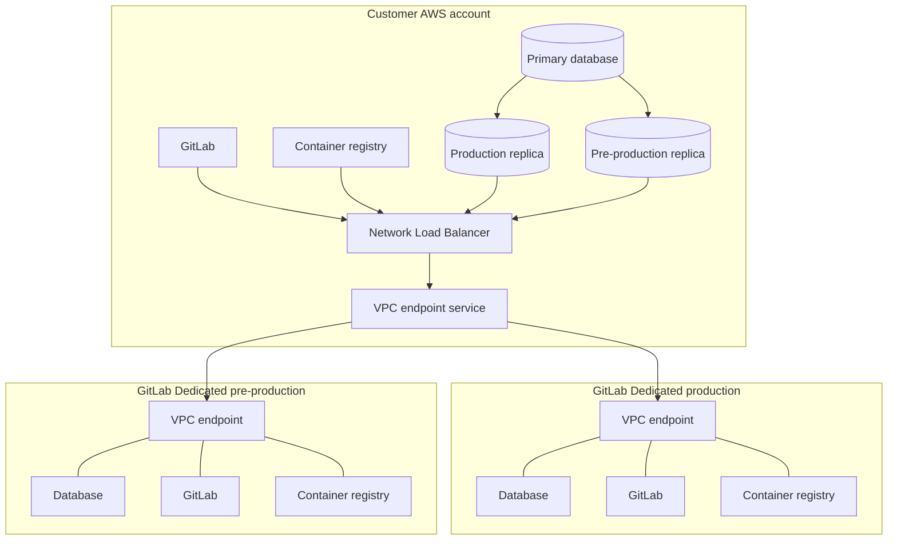



- プラン: Ultimate
- 提供形態: GitLab Dedicated



移行は、GitLab Dedicatedインスタンスが作成されると開始します。そこから、準備期間、レプリケーション期間を経て、2回のカットオーバー（プレプロダクション、次に本番環境）へと進みます。プレプロダクションカットオーバーはプロセスのリハーサルを行い、本番環境カットオーバーで移行を完了する前にインテグレーションをテストする環境を提供します。

## 移行アーキテクチャ {#migration-architecture}

移行中、プレプロダクションテナントと本番環境テナントの2つのGitLab Dedicatedテナントが、単一のソースインスタンスに接続します。お客様側で2つのデータベース読み取りレプリカとAWS接続を提供し、両方のテナントが同じパスを使用します。

> [!note]
> 図には2つのGitLab Dedicatedテナントが表示されていますが、お客様が提供するのは単一の本番環境インスタンスのみです。GitLabが両方のテナントをプロビジョニングし、維持管理します。詳細については、[移行フェーズ](_index.md#migration-phases)を参照してください。

この図はAWS RDS読み取りレプリカを示しており、これはソースがAWSで実行されている場合に該当します。ソースが別のクラウドまたはオンプレミスで実行されている場合は、独自の環境で読み取りレプリカを作成し、インターネットまたはIPsecサイト間VPN経由で接続を提供します。

## 発見、計画、インスタンスの作成 {#discovery-planning-and-instance-creation}

GitLab Dedicatedの購入を確定する前に、ソリューションアーキテクトまたはアカウントエグゼクティブが、[GitLab Discovery Toolkit](https://gitlab.com/gitlab-com/gl-infra/gitlab-dedicated/customer-tools/gitlab-discovery-toolkit)、[GitLab Evaluate](https://gitlab.com/gitlab-org/professional-services-automation/tools/utilities/evaluate)、および[GitLabSOS](https://gitlab.com/gitlab-com/support/toolbox/gitlabsos)などのログバンドルを使用して、現在の環境に関する情報を収集するのを支援します。GitLabは、その出力から移行の実現可能性、規模、タイムラインを評価し、満たす必要がある要件を特定します。

購入が完了した後、お客様自身でGitLab Dedicatedインスタンスを作成するか、希望する場合はGitLabプロフェッショナルサービスがお客様と共に作成します。AWSリージョンやアクセス方法など、作成時に行う決定は移行に影響するため、まず移行チームと調整してください。詳細については、[GitLab Dedicatedインスタンスの作成](../create_instance/_index.md)および[Geo移行の要件](requirements.md#instance-decisions)を参照してください。

## 準備 {#preparation}

準備は、レプリケーションが依存するすべての基盤を構築するフェーズです。この作業は自分で行うことも、GitLabプロフェッショナルサービスと共に行うこともできます。詳細については、[Geo移行の要件](requirements.md)を参照してください。

レプリケーションを開始するには、次の項目を完了する必要があります:

1. GitLab Self-ManagedインスタンスをGeoプライマリサイトとして設定し、検証が既存データのチェックサムの生成を開始できるようにします。
1. 使用中のすべてのデータタイプをオブジェクトストレージに移動します。
1. Gitalyのストレージ名を、GitLab Dedicatedがサポートする名前に合わせます。
1. 2つのデータベース読み取りレプリカを作成し、GitLab Dedicatedからそれらおよびお客様のGitLabインスタンスへの接続を提供します。ソースがAWSにある場合は、1つのTerraformモジュールで両方を実行できます。

次の項目は並行して完了でき、レプリケーションの前ではなく、プレプロダクションカットオーバーの前に完了させてください:

- 10を超えるエンドポイントが必要な場合は、送信プロキシを含む、プライベートターゲットに到達するインテグレーション用の送信接続。
- GitLab Dedicatedがサポートしていない機能の代替。該当する場合は、LDAPからの移行を早めに開始してください。

このフェーズは通常最も時間がかかり、その期間はデータ量よりも環境に大きく左右されます。

## Geoレプリケーション {#geo-replication}

接続が確立され、インスタンスがGeoプライマリサイトとして設定されると、GitLab Dedicatedセカンダリサイトへのレプリケーションが開始されます。

ソースインスタンスはその間も引き続きユーザーにサービスを提供します。レプリケーション中にダウンタイムは発生しません。管理者エリアのGeoサイトセクションで、GitLab Self-Managedインスタンスから進行状況を監視します。詳細については、[Geo](../../geo/_index.md)を参照してください。

レプリケーションは控えめな並行処理の制限で開始します。管理者エリアのセカンダリサイトエントリで、プライマリサイトの負荷を監視し、安定性を確認しながら、チューニング設定を使用して制限を増やしてください。詳細については、[同期および検証の並行処理の値の変更](../../geo/replication/tuning.md#changing-the-syncverification-concurrency-values)を参照してください。

所要時間は主にオブジェクトストレージ内のデータ量によって決まります。初期計画としては、週あたり約10TBのオブジェクトストレージデータというおおまかな割合を想定し、レプリケーションが実行された後は観測された割合を使用してください。ネットワーク帯域幅、オブジェクト数、設定されているレート制限も所要時間に影響するため、移行チームがお客様のデータに対する見積もりを確認します。

ほとんどの一時的な同期エラーは、レプリケーションが続行するにつれて解決します。

すべてのデータタイプが、管理者エリアのGeoサイトセクションで少なくとも99.9%の同期および検証を報告している場合、レプリケーションはプレプロダクションカットオーバーの準備が整っています。完全な同期を目標とする本番環境カットオーバーの前に、お客様とGitLabプロフェッショナルサービスが残りの項目を共同で調査し、解決します。詳細については、[同期と検証のトラブルシューティング](../../geo/replication/troubleshooting/synchronization_verification.md)を参照してください。

## バージョンの整合 {#version-alignment}

レプリケーションが開始されるまでに、ソースインスタンスと両方のGitLab Dedicatedテナントは同じGitLabバージョンを実行します。

レプリケーション中、移行チームはお客様とアップグレードを調整し、ソースインスタンスとGitLab Dedicatedテナントが連携して移動し、整合性を保つようにします。通常、この期間中に1回の協調アップグレードが行われます。

プレプロダクションカットオーバーから本番環境カットオーバーまでの間、両側でアップグレードが凍結され、テスト中に何も変化しないようにします。

本番環境カットオーバー後、残りのアップグレードによって、インスタンスはGitLab Dedicatedフリート全体が実行しているバージョンに追いつきます。詳細については、[バージョンの追いつき](post_cutover.md#version-catch-up)を参照してください。GitLab Dedicatedは、現在のGitLabリリースに対して1つ前のマイナーバージョンを実行します。詳細については、[バージョニングモデル](../releases.md#versioning-model)を参照してください。計画されたアップグレード日については、[GitLab Dedicated情報ポータル](https://gitlab-com.gitlab.io/cs-tools/gitlab-cs-tools/dedicated-info-portal/)を参照してください。

## プレプロダクションカットオーバー {#pre-production-cutover}

プレプロダクションカットオーバーは、GitLab Dedicatedプレプロダクションテナントに対して実行される、本番環境カットオーバーの完全なリハーサルです。

このリハーサルには2つの目的があります。これにより、プロセスをエンドツーエンドで検証し、実際のカットオーバーにかかる時間を計測することで、本番環境カットオーバーに驚きがないようにします。また、本番環境カットオーバーの前にインテグレーションをテストするための、稼働中のインスタンスも提供されます。

リハーサルはプレプロダクションテナントに対して本番環境カットオーバーと同じ手順で行われるため、ソースインスタンスは引き続きユーザーにサービスを提供し、本番環境のDNSは変更されません。移行チームは、プレプロダクションテナントに到達するために使用するホスト名と、必要なIdentity Providerの設定についてお客様と確認します。

プレプロダクションカットオーバーは、本番環境カットオーバーで目標とされる100%ではなく、99.9%のデータ完全性を目標とします。そのため、軽微な同期の失敗はリハーサル中は保留にでき、本番環境カットオーバーの前に対応されます。

アップグレードの凍結はこの時点で開始し、本番環境カットオーバーまで継続します。

## テスト期間 {#testing-period}

プレプロダクションカットオーバーの後、移行されたインスタンスを検証します。この期間は通常数週間続きます。

次の項目を検証してください:

- Identity Provider経由でのサインイン
- プロジェクトの参照と作成
- HTTPSとSSHの両方でのクローンとプッシュ
- CI/CDパイプラインの実行
- `docker login`、プル、プッシュによるコンテナレジストリへのアクセス
- 内部ターゲットへのWebhookの配信
- メールの配信
- プライベートターゲットに到達するインテグレーション
- 異なるオンサイトまたはVPNロケーションからの接続

カットオーバー日より前に、移行チームと本番環境カットオーバーのgoまたはno-goの基準について合意してください。

凍結期間中はインスタンスがアップグレードを受けないため、凍結期間はできるだけ短くしてください。

## 本番環境カットオーバー {#production-cutover}

本番環境カットオーバーはお客様と日程を調整して行われ、その間データを書き込むことができないため、ダウンタイムのウィンドウが必要です。

カットオーバーは次の順序で実行されます:

1. ソースインスタンスをメンテナンスモードにし、新しいデータの書き込みを停止します。
1. レプリケーションが残りの項目を完了します。
1. GitLabがソースデータベースをGitLab Dedicatedデータベースにコピーします。所要時間はデータベースの量によって異なり、プレプロダクションリハーサル中に計測されます。
1. GitLabがテナントを再設定し、プライマリサイトに昇格させます。
1. [カスタムドメイン](../configure_instance/network_security.md#custom-domains)を使用している場合は、GitLab Dedicatedを指すようにDNSレコードを更新してください。
1. GitLabがサイトを再設定し、カスタムドメインの証明書発行が完了するようにします。
1. サイトに接続し、Identity Provider経由でサインインします。インスタンスはまだメンテナンスモードであるため、データが書き込まれる前にアクセスを確認し、プロジェクトとリポジトリを読み取ることができます。
1. メンテナンスモードを無効にします。
1. リポジトリへのプッシュ、パイプラインの実行、コンテナレジストリへのプッシュなど、書き込みの確認を実施します。

> [!warning]
> メンテナンスモードが解除されると、インスタンスは書き込み可能になります。ソースインスタンスに戻ると、その時点以降に書き込まれたデータは失われます。このため、goまたはno-goの決定はカットオーバーの前に行われます。

## 移行後の管理 {#administration-after-migration}

移行後も、アプリケーション管理は引き続き行います:

- GitLab UI経由での管理者アクセス
- ユーザーとグループの管理
- プロジェクトとリポジトリの管理
- CI/CD設定

GitLabがインフラストラクチャの管理を引き継ぎます:

- 基盤となるインフラストラクチャの管理。サーバーへのShellアクセスはありません。
- アップグレード。インスタンスは割り当てられたメンテナンスウィンドウ中にアップグレードされ、アップグレード日を選択することはできません。詳細については、[メンテナンス](../maintenance.md)および[リリース](../releases.md)を参照してください。
- 一部の設定は、管理者エリアではなくSwitchboardで管理されます。詳細については、[テナント概要](../tenant_overview.md)を参照してください。

## 関連トピック {#related-topics}

- [GitLab DedicatedへのGeo移行](_index.md)
- [Geo移行の要件](requirements.md)
- [Geo移行のシークレットの収集](secrets.md)
- [移行後のアクティビティ](post_cutover.md)
