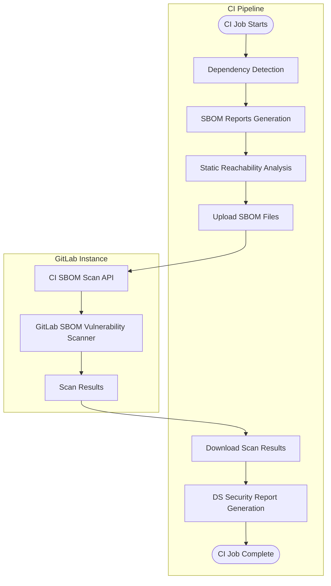



- プラン: Ultimate
- 提供形態: GitLab.com、GitLab Self-Managed、GitLab Dedicated





- GitLab 17.4で、デフォルトブランチのみを対象とする[実験的機能](../../../../policy/development_stages_support.md#experiment)として、`dependency_scanning_using_sbom_reports`という名前の[機能フラグ付きで](../../../../administration/feature_flags/_index.md)[導入されました](https://gitlab.com/groups/gitlab-org/-/work_items/8026)。デフォルトでは無効になっています。
- GitLab 17.5で、[GitLab Self-Managedで有効になりました](https://gitlab.com/gitlab-org/gitlab/-/issues/395692)。
- GitLab 17.9で、実験的機能からベータ版に[変更](https://gitlab.com/groups/gitlab-org/-/work_items/15960)され、すべてのブランチをサポートするようになりました。また、Cargo、Conda、Cocoapods、Swiftについては、[最新の依存関係スキャンCI/CDテンプレートでデフォルトで有効](https://gitlab.com/gitlab-org/gitlab/-/issues/519597)になりました。
- 機能フラグ`dependency_scanning_using_sbom_reports`は、GitLab 17.10で削除されました。
- GitLab 18.5で、ベータ版から、GitLab.comのみを対象とした限定提供に[変更](https://gitlab.com/groups/gitlab-org/-/work_items/15960)されました。これに伴い、新しい[V2 CI/CD依存関係スキャンテンプレート](https://gitlab.com/gitlab-org/gitlab/-/merge_requests/201175/)が追加され、`dependency_scanning_sbom_scan_api`という名前の[機能フラグ付き](../../../../administration/feature_flags/_index.md)で提供されます。デフォルトでは無効になっています。
- 機能フラグ`dependency_scanning_using_sbom_reports`は、GitLab 18.10で[デフォルトで有効](https://gitlab.com/gitlab-org/gitlab/-/work_items/551861)になりました。
- GitLab 19.0で[一般提供](https://gitlab.com/groups/gitlab-org/-/work_items/20456)になりました。



CycloneDXソフトウェア部品表（SBOM）を使用した依存関係スキャンでは、アプリケーションの依存関係に既知の脆弱性がないかを分析します。すべての依存関係がスキャンされます。
[推移的依存関係も含まれます](../_index.md)。

依存関係スキャンは、多くの場合、ソフトウェアコンポジション解析（SCA）の一部と見なされます。SCAでは、コードが使用しているさまざまな要素を調査対象とすることがあります。これらの要素には、通常、アプリケーションの依存関係とシステムの依存関係が含まれます。これらはほとんどの場合、自分で作成したものではなく、外部のソースからインポートされたものです。

依存関係スキャンは、アプリケーションのライフサイクルにおける開発フェーズで実行できます。CI/CDパイプラインで新しい依存関係スキャンのアナライザーを使用すると、プロジェクトの依存関係が検出され、CycloneDX SBOMレポートに記録されます。セキュリティ検出結果が特定され、ソースブランチとターゲットブランチの間で比較されます。検出結果とその重大度はマージリクエストに一覧表示されるため、コードの変更をコミットする前に、アプリケーションへのリスクに事前に対処できます。報告されたSBOMコンポーネントのセキュリティ検出結果は、新しいセキュリティアドバイザリーが公開された際に、[継続的脆弱性スキャン](../../continuous_vulnerability_scanning/_index.md)によっても、CI/CDパイプラインとは無関係に特定されます。

GitLabでは、これらすべての依存関係の種類を確実にカバーするために、依存関係スキャンと[コンテナスキャン](../../container_scanning/_index.md)の両方を提供しています。リスクのある領域をできるだけ広くカバーするため、GitLabのすべてのセキュリティスキャナーを使用することをおすすめします。これらの機能の比較については、[依存関係スキャンとコンテナスキャンの比較](../../comparison_dependency_and_container_scanning.md)を参照してください。

新しい依存関係スキャンのアナライザーに関するフィードバックは、この[フィードバックイシュー](https://gitlab.com/gitlab-org/gitlab/-/issues/523458)にお寄せください。

## 依存関係スキャンを有効にする {#turn-on-dependency-scanning}

プロジェクトで依存関係スキャンを有効にします。

### 前提条件 {#prerequisites}

すべてのGitLabインスタンスに共通の前提条件:

- プロジェクトのデベロッパー、メンテナー、またはオーナーロール。
- [サポートされているロックファイルまたは依存関係グラフのエクスポート](#supported-languages-and-files)。リポジトリにコミットされているか、CI/CDパイプラインで作成され、アーティファクトとして`dependency-scanning`ジョブに渡されている必要があります。または、[依存関係の解決](#dependency-resolution)によって、サポート対象のエコシステムに必要なファイルを生成することもできます。あるいは、フォールバックとして[マニフェストファイル](#manifest-fallback)を使用することもできます。
- セルフマネージドRunnerの場合は、[`docker`](https://docs.gitlab.com/runner/executors/docker/)または[`kubernetes`](https://docs.gitlab.com/runner/install/kubernetes/) executorを使用するGitLab Runner。
- GitLab.comのホスト型Runnerの場合、この設定はデフォルトで有効になっています。

GitLab Self-Managedのみ: スキャン対象となるすべてのPURLタイプの[パッケージメタデータ](../../../../administration/settings/security_and_compliance.md#choose-package-registry-metadata-to-sync)を、GitLabインスタンスで同期しておく必要があります。このデータがGitLabインスタンスで利用できない場合、依存関係スキャンは脆弱性を特定できません。

### プロジェクトのパイプライン設定を更新する {#update-project-pipeline-configuration}

依存関係スキャンを有効にするには、依存関係スキャンテンプレートをプロジェクトのパイプライン設定に追加する必要があります。

デフォルトでは、`Dependency-Scanning.v2.gitlab-ci.yml`テンプレートは、マージリクエストパイプラインで依存関係スキャンジョブを実行します。プロジェクトで他のジョブにマージリクエストパイプラインを使用していない場合、マージリクエストパイプラインには依存関係スキャンジョブのみが表示され、他のすべてのジョブは別のブランチパイプラインで実行されます。この動作を無効にするには、[依存関係スキャンのMRパイプラインを無効にする](#disable-merge-request-pipelines-for-dependency-scanning)を参照してください。

GitLab UIから依存関係スキャンを有効にするには:

1. 上部のバーで、**検索または移動先**を選択し、プロジェクトを見つけます。
1. 左側のサイドバーで、**コード** > **リポジトリ**を選択します。
1. `.gitlab-ci.yml`ファイルを選択します。
1. **編集** > **単一ファイルを編集**を選択します。
1. `Dependency-Scanning.v2` CI/CDテンプレートを追加します:

   ```yaml
   include:
     - template: Jobs/Dependency-Scanning.v2.gitlab-ci.yml
   ```

1. **変更をコミット**を選択します。

## 利用可能なコンテナイメージ {#available-container-images}

この機能は、CIジョブの実行にコンテナイメージを使用します。デフォルトのCIジョブ定義では、これらのイメージをメジャーバージョンタグ（例: `dependency-scanning:2`）で参照するため、CI/CD設定を変更しなくても、パッチおよびマイナーアップデートが自動的に適用されます。

### メンテナンスポリシー {#maintenance-policy}

GitLabは[リリースおよびメンテナンスポリシー](../../../../policy/maintenance.md)に従い、現在の安定版リリースにはバグ修正を、直前の2つの月次リリースにはセキュリティ修正を提供します。

CI/CDジョブはイメージをメジャーバージョンタグ（例: `dependency-scanning:2`）で参照するため、修正は、そのメジャーイメージバージョンと互換性のあるすべてのGitLabバージョンで自動的に利用できます。

このポリシーは、以下に記載されているイメージに適用されます。以前のイメージはこのポリシーの対象外です。

### 現在のイメージ {#current-images}

| CI/CDジョブ | 本番環境のイメージ | GitLabバージョン |
| --------------------------------------- | ------------------------------------------------------------------------------------------------------- | -------------- |
| `dependency-scanning` | `registry.gitlab.com/security-products/dependency-scanning:2` | `19.x` |
| `dependency-scanning:maven-resolution` | `registry.gitlab.com/security-products/dependency-resolution/ubi9/openjdk-21:1` | `18.x`、`19.x` |
| `dependency-scanning:gradle-resolution` | `registry.gitlab.com/security-products/dependency-resolution/ubi9/openjdk-17-with-gradle-8:1` | `19.x` |
| `dependency-scanning:python-resolution` | `registry.gitlab.com/security-products/dependency-resolution/ubi9/python-312-minimal-with-piptools-7:9` | `18.x`、`19.x` |

現在のイメージは、ベースイメージのベンダーによるアップストリームのパッチを取り込むために、定期的に再ビルドされます。

### 以前のイメージ {#previous-images}

これらのイメージは非推奨となっており、バグ修正や新機能は提供されません。コンテナレジストリでは引き続き利用でき、対応するGitLabバージョンでは動作し続けます。非推奨のイメージを新しいバージョンのGitLabで使用することはサポートされておらず、予期しない結果になる可能性があります。

| CI/CDジョブ | 本番環境のイメージ | GitLabバージョン | 非推奨になったバージョン |
| --------------------- | ------------------------------------------------------------- | -------------- | ------------- |
| `dependency-scanning` | `registry.gitlab.com/security-products/dependency-scanning:1` | `18.x` | `19.0` |
| `dependency-scanning` | `registry.gitlab.com/security-products/dependency-scanning:0` | `18.x` | `19.0` |

### FIPSコンプライアンス {#fips-compliance}

依存関係スキャンのアナライザーイメージとすべての[依存関係解決イメージ](#dependency-resolution)は、FIPS 140検証済みの暗号モジュールを使用する[Red Hat UBI](https://www.redhat.com/en/blog/introducing-red-hat-universal-base-image)をベースにしています。FIPSが有効な環境でも、追加の設定は必要ありません。

## 結果を理解する {#understanding-the-results}

依存関係スキャンのアナライザーは、次のものを出力します:

- 検出されたサポート対象のロックファイルまたは依存関係グラフのエクスポートごとのCycloneDX SBOM。
- スキャンされたすべてのSBOMドキュメントを対象とした、単一の依存関係スキャンレポート。

> [!note]
> アナライザーが[サポート対象のファイル](#supported-languages-and-files)を見つけられない場合、依存関係スキャンジョブは正常に完了し、CI/CDジョブログに警告が出力されます。この場合、CycloneDX SBOMや依存関係スキャンレポートは生成されません。

### CycloneDXソフトウェア部品表 {#cyclonedx-software-bill-of-materials}

依存関係スキャンのアナライザーは、サポート対象のロックファイル、依存関係グラフ、またはマニフェストファイルが検出されたディレクトリごとに、[CycloneDX](https://cyclonedx.org/)ソフトウェア部品表（SBOM）を出力します。CycloneDX SBOMはジョブアーティファクトとして作成されます。

CycloneDX SBOMには、次の特徴があります:

- 名前は`gl-sbom-<package-type>-<package-manager>.cdx.json`です。
- 依存関係スキャンジョブのジョブアーティファクトとして利用できます。
- `cyclonedx`レポートとしてアップロードされます。
- 検出されたロックファイルまたは依存関係グラフファイルと同じディレクトリに保存されます。

たとえば、プロジェクトが次の構造になっているとします:

```plaintext
.
├── ruby-project/
│   └── Gemfile.lock
├── ruby-project-2/
│   └── Gemfile.lock
└── php-project/
    └── composer.lock
```

次のCycloneDX SBOMがジョブアーティファクトとして作成されます:

```plaintext
.
├── ruby-project/
│   ├── Gemfile.lock
│   └── gl-sbom-gem-bundler.cdx.json
├── ruby-project-2/
│   ├── Gemfile.lock
│   └── gl-sbom-gem-bundler.cdx.json
└── php-project/
    ├── composer.lock
    └── gl-sbom-packagist-composer.cdx.json
```

### 依存関係スキャンレポート {#dependency-scanning-report}

依存関係スキャンのアナライザーは、CycloneDX SBOMファイルで特定された依存関係に含まれる、すべての脆弱性を記録した依存関係スキャンレポートを生成します。

依存関係スキャンレポートには、次の特徴があります:

- 名前は`gl-dependency-scanning-report.json`です。
- 依存関係スキャンジョブのジョブアーティファクトとして利用できます。
- `dependency_scanning`レポートとしてアップロードされます。
- プロジェクトのルートディレクトリに保存されます。

### 悪意のあるパッケージ {#malicious-packages}



- ステータス: ベータ版



依存関係スキャンは、CycloneDX SBOMを取り込む際に、悪意のあるパッケージを特定します。GitLabは、通常のセキュリティアドバイザリーに加えて、[GitLabマルウェアアドバイザリー](../../gitlab_advisory_database/_index.md#gitlab-malware-advisories)とSBOM内のコンポーネントを照合します。一致した場合、脆弱性が作成されます。

悪意のあるパッケージの検出結果は、攻撃者が悪用できる欠陥がパッケージに含まれているのではなく、パッケージ自体が有害であることを意味します。これは、パッケージが人気のあるパッケージの名前をタイポスクワットしている場合、侵害されたメンテナーアカウントが有害なリリースを公開した場合、またはパッケージにマルウェアのように動作するよう作成されたコードが含まれている場合に発生します。検出結果は特定の欠陥ではなくパッケージ自体を対象としているため、CVEレコードに基づく検出結果とは異なり、脆弱性が事前に公開されていることに依存せずに検出できます。

悪意のあるパッケージの検出結果の脆弱性の詳細ページには、解決策がなく、CVSS、Exploit Prediction Scoring System（EPSS）、既知の悪用された脆弱性（KEV）の情報も含まれません。マルウェアアドバイザリーには、これらのデータが含まれていないためです。これらのフィールドは、欠陥がどの程度悪用可能か、およびその修正方法を示すものであり、それ自体が悪意のあるパッケージには当てはまりません。悪意のあるパッケージの検出結果を解決するには、パッケージをアップグレードするのではなく、プロジェクトから削除してください。

これらの脆弱性の重大度は、常に`Critical`です。マルウェアアドバイザリーでは、共通脆弱性評価システム（CVSS）のスコアから重大度を導出するのではなく、重大度が直接示されます。

各脆弱性には、`GLAM-<year>-<month>-<sequence>`という形式の識別子（例: `GLAM-2026-09-00138`）が付与されます。共通脆弱性識別子（CVE）は付与されません。

マルウェアアドバイザリーがカバーするパッケージタイプは、依存関係スキャンが一般的にサポートするパッケージタイプよりも少なくなっています。完全な一覧については、[サポートされているパッケージタイプ](../../gitlab_advisory_database/_index.md#supported-package-types)を参照してください。

この機能はGitLab Ultimateで利用でき、有効にするための個別の設定はありません。プロジェクトの既存の依存関係スキャンの設定に従います。GitLab Self-Managedでは、対象となるパッケージレジストリも、[前提条件](#prerequisites)で説明しているパッケージメタデータの同期に従います。

GitLabがマルウェアアドバイザリーを撤回した場合、そのアドバイザリーとの照合は停止され、そのアドバイザリーから新たに脆弱性が作成されることはありません。

[継続的脆弱性スキャン](../../continuous_vulnerability_scanning/_index.md#malicious-packages)は、パイプラインを実行しなくても、これと同じ照合を実行します。

マルウェアの検出結果は、[脆弱性レポート](../../vulnerability_report/_index.md)と[依存関係リスト](../../dependency_list/_index.md)に表示されます。どちらも、影響を受ける脆弱性または依存関係に赤いマルウェアバッジが表示され、マルウェアのステータスでフィルタリングできます。

#### 既知の制限事項 {#known-limitations}

依存関係スキャンでのマルウェアの照合には、次の制限事項があります:

- GitLabはデフォルトブランチ上のコンポーネントのみを評価し、他のブランチ上のコンポーネントについては検出結果を生成しません。
- すでに使用しているパッケージに対して新しいマルウェアアドバイザリーが公開されても、GitLabから事前に通知されることはありません。次に脆弱性レポートを確認したときに、検出結果が表示されます。
- 1つの検出結果に、同じアドバイザリーIDが2回（`GLAM-<year>-<month>-<sequence>`と`Gemnasium-GLAM-<year>-<month>-<sequence>`という識別子として）表示されます。この重複するエントリは識別子の表示方法にのみ影響し、検出や重複排除には影響しません。詳細については、[イシュー627314](https://gitlab.com/gitlab-org/gitlab/-/issues/627314)を参照してください。
- GitLabは、のちに撤回されたアドバイザリーから作成された脆弱性を解決済みにしません。これらの脆弱性は、ユーザーが解決するまで脆弱性レポートに残ります。詳細については、[イシュー612099](https://gitlab.com/gitlab-org/gitlab/-/issues/612099)を参照してください。

## スキャンのパフォーマンスを向上させる {#improve-scanning-performance}

依存関係スキャンのパフォーマンスを左右する主な要因は、スキャン対象の依存関係の数です。デフォルトでは、依存関係スキャンは次のスコープで動作します:

- サポート対象のすべての言語とファイルが含まれます。
- ルートディレクトリとその直下のサブディレクトリが含まれます。
- 隠しディレクトリは除外されます。

パフォーマンスを向上させるには、特定のパスを除外する、スキャンするディレクトリの深さを制限する、開発用およびテスト用の依存関係を除外する、といった方法があります。

### スキャンの制限 {#scan-limits}

各プロジェクトには、パイプライン全体で1時間あたり50件のSBOMスキャンというソフトスロットルが設定されています。この制限を超えたスキャンも、より低い優先度で受け付けられるため、モノレポなど大量のスキャンを行うプロジェクトでは、スキャン時間が長くなる可能性があります。

このスロットルは設定できません。詳細については、[SBOMを使用した依存関係スキャンの制限](../../../../administration/instance_limits.md#dependency-scanning-using-sbom-limits)を参照してください。

### スキャンからパスを除外する {#exclude-paths-from-scanning}

スキャンのパフォーマンスを向上させるには、パスを除外します。たとえば、ドキュメントを含むパスを除外できます。パスを除外する際は、脆弱性が見落とされないよう、慎重に選択してください。

除外するパスは、`.gitlab-ci.yml`ファイルに記述します:

- 依存関係スキャンテンプレートの場合は、`DS_EXCLUDED_PATHS` CI/CD変数を使用します。
- 依存関係スキャンCI/CDコンポーネントの場合は、`excluded_paths` specインプットを使用します。

複数のパターンを指定するには、スペースを入れずにカンマで区切ります。次に例を示します:

```yaml
variables:
  DS_EXCLUDED_PATHS: "**/*.Test/**,**/*.Test.*/**,src/Test/**"
```

除外パターンは、次のルールに従います:

- スラッシュを含まないパターンは、プロジェクト内の任意の深さにあるファイル名またはディレクトリ名に一致します。たとえば、`test`は`./test`と`src/test`に一致します。
- スラッシュを含むパターンは、そのパターンで始まるパスに一致します。たとえば、`a/b`は`a/b`と`a/b/c`に一致しますが、`c/a/b`には一致しません。
- 標準的なglobワイルドカードがサポートされています。たとえば、`a/**/b`は`a/b`、`a/x/b`、`a/x/y/b`に一致します。
- 先頭と末尾のスラッシュは無視されます。たとえば、`/build`と`build/`は、`build`と同じ結果に一致します。
- カンマの後ろのスペースはパターンの一部となり、一致に失敗する原因になります。`"path/a/**, path/b/**"`ではなく、`"path/a/**,path/b/**"`を使用してください。

### スキャンするディレクトリの深さを制限する {#limit-scan-directory-depth}

デフォルトでは、スキャンはリポジトリのルートディレクトリとその直下のサブディレクトリのみを対象に、パッケージマネージャーのファイルを検索します。スキャンのパフォーマンスを向上させるには、ディレクトリの最大深度を`1`に設定して、検索をリポジトリのルートディレクトリのみに限定します。関連するすべてのパッケージマネージャーのファイルがリポジトリに含まれるよう、注意してください。

スキャンするディレクトリの最大深度を`.gitlab-ci.yml`ファイルで指定するには:

- 依存関係スキャンテンプレートの場合は、`DS_MAX_DEPTH` CI/CD変数を使用します。
- 依存関係スキャンCI/CDコンポーネントの場合は、`max_scan_depth` specインプットを使用します。

次の例では、`DS_MAX_DEPTH`が`1`に設定されているため、依存関係スキャンは`timer`ディレクトリのみでパッケージマネージャーのファイルを検索します。サブディレクトリはスキャンしません。

```plaintext
timer
├── integration
└── source
```

### 開発用およびテスト用の依存関係を除外する {#exclude-development-and-test-dependencies}

デフォルトでは、開発用およびテスト用の依存関係もスキャンに含まれます。スキャンのパフォーマンスを向上させるには、次のいずれかを設定して除外します:

- CI/CD変数`DS_INCLUDE_DEV_DEPENDENCIES`を`"false"`にする
- CI/CDコンポーネントのインプット`include_dev_dependencies`をfalseにする

サポートされているのは、次のパッケージマネージャーを使用するプロジェクトのみです: Composer、Conda、Gradle、Maven、npm、pnpm、Pipenv、Poetry、uv。

## ロールアウト {#roll-out}

1つのプロジェクトでSBOMを使用した依存関係スキャンの結果に確信が持てたら、その実装を複数のプロジェクトやグループに拡大できます。詳細については、[複数のプロジェクトでスキャンを強制する](#enforce-scanning-on-multiple-projects)を参照してください。

独自の要件がある場合は、SBOMを使用した依存関係スキャンを[オフライン環境](#offline-environment)で実行できます。

## サポートされているパッケージタイプ {#supported-package-types}

セキュリティ分析を有効に機能させるには、SBOMレポートに記載されているコンポーネントが、[GitLabアドバイザリーデータベース](../../gitlab_advisory_database/_index.md)に対応するエントリを持っている必要があります。

GitLab SBOM脆弱性スキャナーは、次の[PURLタイプ](https://github.com/package-url/purl-spec/blob/346589846130317464b677bc4eab30bf5040183a/PURL-TYPES.rst)のコンポーネントについて、依存関係スキャンの脆弱性を報告できます:

- `cargo`
- `composer`
- `conan`
- `gem`
- `golang`
- `maven`
- `npm`
- `nuget`
- `pypi`
- `swift`

## サポートされている言語とファイル {#supported-languages-and-files}



- Bunのサポートは、GitLab 19.2で[導入されました](https://gitlab.com/gitlab-org/gitlab/-/work_items/592701)。



| 言語 | パッケージマネージャー | ファイル | 説明 | 依存関係グラフのエクスポートのサポート | 静的到達可能性のサポート |
| ------------------------- | --------------- | ----------------------------------------------- | ------------------------------------------------------------------------------------------------------------------------------------------------------------------------------------- | ------------------------------- | --------------------------- |
| C# | NuGet | `packages.lock.json` | `nuget`によって生成されたロックファイル。 |  |  |
| C/C++ | Conan | `conan.lock` | `conan`によって生成されたロックファイル。 |  |  |
| C/C++/Fortran/Go/Python/R | Conda | `conda-lock.yml` | `conda-lock`によって生成された環境ファイル。 |  |  |
| Dart | pub | `pubspec.lock`、`pub.graph.json` | `pub`によって生成されたロックファイル。依存関係グラフのエクスポートは、`dart pub deps --json > pub.graph.json`から得られます。 |  |  |
| Go | go | `go.mod`、`go.graph` | 標準の`go`ツールチェーンによって生成されたモジュールファイル。依存関係グラフのエクスポートは、`go mod graph > go.graph`から得られます。 |  |  |
| Java | ivy | `ivy-report.xml` | Apache Antの`report`タスクによって生成された依存関係グラフのエクスポート。 |  |  |
| Java | Maven | `maven.graph.json` | `mvn dependency:tree -DoutputType=json`によって生成された依存関係グラフのエクスポート。 |  |  |
| Java | Maven | `pom.xml` | [依存関係の解決](#dependency-resolution)で使用される、または依存関係グラフのエクスポートが利用できない場合に[マニフェストフォールバック](#manifest-fallback)として使用されるMavenマニフェストファイル。 |  |  |
| Java/Kotlin | Gradle | `gradle.graph.txt` | `./gradlew dependencies`によって生成された依存関係グラフのエクスポート。 |  |  |
| Java/Kotlin | Gradle | `dependencies.lock`、`dependencies.direct.lock` | [gradle-dependency-lock-plugin](https://github.com/nebula-plugins/gradle-dependency-lock-plugin)によって生成されたロックファイル。 |  |  |
| Java/Kotlin | Gradle | `gradle.lockfile` | `gradle dependencies --write-locks`によって生成されたロックファイル。 |  |  |
| Java/Kotlin | Gradle | `gradle-html-dependency-report.js` | [htmlDependencyReport](https://docs.gradle.org/current/dsl/org.gradle.api.tasks.diagnostics.DependencyReportTask.html)タスクによって生成された依存関係グラフのエクスポート。 |  |  |
| Java/Kotlin | Gradle | `build.gradle`、`build.gradle.kts` | [依存関係の解決](#dependency-resolution)で使用される、またはロックファイルや依存関係グラフのエクスポートが利用できない場合に[マニフェストフォールバック](#manifest-fallback)として使用されるGradleビルドファイル。 |  |  |
| JavaScript/TypeScript | Bun | `bun.lock` | `bun`によって生成されたロックファイル。 |  |  |
| JavaScript/TypeScript | npm | `package-lock.json`、`npm-shrinkwrap.json` | `npm` v5以降によって生成されたロックファイル（`lockfileVersion`属性を生成しない以前のバージョンはサポートされません）。 |  |  |
| JavaScript/TypeScript | pnpm | `pnpm-lock.yaml` | `pnpm`によって生成されたロックファイル。 |  |  |
| JavaScript/TypeScript | yarn | `yarn.lock` | `yarn`によって生成されたロックファイル。 |  |  |
| Objective-C | CocoaPods | `Podfile.lock` | `cocoapods`によって生成されたロックファイル。検出のみ: SBOMは生成されますが、CocoaPodsのコンポーネントは[依存関係リスト](../../dependency_list/_index.md)に表示されず、脆弱性アドバイザリーとの照合も行われず、ライセンススキャンにも含まれません。[^cocoapods-detection-only] |  |  |
| PHP | composer | `composer.lock` | `composer`によって生成されたロックファイル。 |  |  |
| Python | pip | `pipdeptree.json` | `pipdeptree --json`によって生成された依存関係グラフのエクスポート。 |  |  |
| Python | pip | `requirements.txt`（ロックファイル） | `pip-compile`によって生成されたロックファイル。 |  |  |
| Python | pip | `requirements.txt` | [依存関係の解決](#dependency-resolution)で使用される、またはロックファイルや依存関係グラフのエクスポートが利用できない場合に[マニフェストフォールバック](#manifest-fallback)として使用されるマニフェストファイル。 |  |  |
| Python | pipenv | `Pipfile.lock` | `pipenv`によって生成されたロックファイル。 |  |  |
| Python | pipenv | `pipenv.graph.json` | `pipenv graph --json-tree >pipenv.graph.json`によって生成された依存関係グラフのエクスポート。 |  |  |
| Python | poetry | `poetry.lock` | `poetry` v1またはv2によって生成されたロックファイル。 |  |  |
| Python | uv[^lockfile-contains-multiple] | `uv.lock` | `uv`によって生成されたロックファイル。 |  |  |
| Ruby | bundler | `Gemfile.lock`、`gems.locked` | `bundler`によって生成されたロックファイル。 |  |  |
| Rust | cargo | `Cargo.lock` | `cargo`によって生成されたロックファイル。 |  |  |
| Scala | sbt | `dependencies-compile.dot` | `sbt dependencyDot`によって生成された依存関係グラフのエクスポート。 |  |  |
| Swift | swift | `Package.resolved` | `swift`によって生成されたロックファイル。 |  |  |

[^cocoapods-detection-only]: `cocoapods` PURLタイプは、サポート対象のパッケージタイプではありません。
    iOSプロジェクトで依存関係リストと脆弱性スキャンを完全にカバーするには、代わりに[Swift Package Manager](https://www.swift.org/documentation/package-manager/)と`Package.resolved`を使用してください。
[^lockfile-contains-multiple]: ロックファイルに、環境マーカーが異なる同じパッケージの複数のエントリが含まれている場合（たとえば、Python 3.11未満ではnumpy==2.2.6、Python 3.11以上ではnumpy==2.4.1）、最初のエントリのみが解析および報告されます。

### パッケージのハッシュ情報 {#package-hash-information}

依存関係スキャンのSBOMには、利用可能な場合、パッケージのハッシュ情報が含まれます。この情報は、NuGetパッケージにのみ提供されます。パッケージのハッシュは、SBOM内の次の場所に記載されており、パッケージの完全性と真正性を検証できます:

- 専用のハッシュフィールド
- PURL修飾子

次に例を示します:

```json
{
  "name": "Iesi.Collections",
  "version": "4.0.4",
  "purl": "pkg:nuget/Iesi.Collections@4.0.4?sha512=8e579b4a3bf66bb6a661f297114b0f0d27f6622f6bd3f164bef4fa0f2ede865ef3f1dbbe7531aa283bbe7d86e713e5ae233fefde9ad89b58e90658ccad8d69f9",
  "hashes": [
    {
      "alg": "SHA-512",
      "content": "8e579b4a3bf66bb6a661f297114b0f0d27f6622f6bd3f164bef4fa0f2ede865ef3f1dbbe7531aa283bbe7d86e713e5ae233fefde9ad89b58e90658ccad8d69f9"
    }
  ],
  "type": "library",
  "bom-ref": "pkg:nuget/Iesi.Collections@4.0.4?sha512=8e579b4a3bf66bb6a661f297114b0f0d27f6622f6bd3f164bef4fa0f2ede865ef3f1dbbe7531aa283bbe7d86e713e5ae233fefde9ad89b58e90658ccad8d69f9"
}
```

## アナライザーの動作をカスタマイズする {#customizing-analyzer-behavior}

アナライザーをカスタマイズする方法は、有効化の方法によって異なります。

> [!warning]
> GitLabアナライザーのカスタマイズはすべて、デフォルトブランチにマージする前に、マージリクエストでテストしてください。テストしないと、多数の誤検出を含む予期しない結果になる可能性があります。

### CI/CDテンプレートで動作をカスタマイズする {#customizing-behavior-with-the-cicd-template}

#### 利用可能なspecインプット {#available-spec-inputs}

次のspecインプットは、`Dependency-Scanning.v2.gitlab-ci.yml`テンプレートと組み合わせて使用できます。

| specインプット | タイプ | デフォルト | 説明 |
| ------------------------------------------- | ------- | --------------------------------------------------------------------------------------------------------- | ----------- |
| `job_name` | string | `"dependency-scanning"` | 依存関係スキャンジョブの名前。 |
| `stage` | string | `test` | 依存関係スキャンジョブのステージ。 |
| `allow_failure` | boolean | `true` | 依存関係スキャンジョブが失敗した場合に、パイプラインを失敗させるかどうか。 |
| `analyzer_image_prefix` | string | `"$CI_TEMPLATE_REGISTRY_HOST/security-products"` | アナライザーのリポジトリを指すレジストリURLのプレフィックス。 |
| `analyzer_image_name` | string | `"dependency-scanning"` | 依存関係スキャンジョブが使用するアナライザーイメージのリポジトリ。 |
| `analyzer_image_version` | string | `"2"` | 依存関係スキャンジョブが使用するアナライザーイメージのバージョン。 |
| `additional_ca_cert_bundle` | string | | 信頼するCA証明書バンドル。ここで指定したCAバンドルはシステムの証明書に追加され、スキャン処理中に他のツールでも使用されます。詳細については、[カスタムTLS認証局](#custom-tls-certificate-authority)を参照してください。 |
| `pip_manifest_file_name_pattern` | string | | 依存関係の解決とマニフェストスキャンに使用する、カスタムのpipマニフェストファイル名パターン。パターンはディレクトリパスではなく、ファイル名のみに一致させる必要があります。構文の詳細については、[doublestarライブラリ](https://www.github.com/bmatcuk/doublestar/tree/v1#patterns)を参照してください。 |
| `pipcompile_lockfile_file_name_pattern` | string | | 解析時に使用する、カスタムのpip-compileロックファイル名パターン。パターンはディレクトリパスではなく、ファイル名のみに一致させる必要があります。構文の詳細については、[doublestarライブラリ](https://www.github.com/bmatcuk/doublestar/tree/v1#patterns)を参照してください。 |
| `pipcompile_requirements_file_name_pattern` | string | | GitLab 19.0で[非推奨](https://gitlab.com/gitlab-org/gitlab/-/work_items/598796)になりました。代わりに`pipcompile_lockfile_file_name_pattern`を使用してください。 |
| `max_scan_depth` | number | `2` | アナライザーがサポート対象のファイルを検索するディレクトリの階層数を定義します。値が-1の場合、アナライザーは深さに関係なくすべてのディレクトリを検索します。 |
| `excluded_paths` | string | `"**/spec,**/test,**/tests,**/tmp"` | スキャンから除外するパスのカンマ区切りリスト（globがサポートされています）。 |
| `include_dev_dependencies` | boolean | `true` | サポート対象のファイルをスキャンする際に、開発用およびテスト用の依存関係を含めます。 |
| `enable_static_reachability` | boolean | `false` | [静的到達可能性](../static_reachability.md)を有効にします。 |
| `enable_manifest_fallback` | boolean | `true` | [マニフェストフォールバック](#manifest-fallback)を有効にします。 |
| `analyzer_log_level` | string | `"info"` | 依存関係スキャンのログレベル。選択肢はfatal、error、warn、info、debugです。 |
| `enable_vulnerability_scan` | boolean | `true` | 生成されたSBOMの脆弱性分析を有効にします。 |
| `api_timeout` | number | `10` | SBOMを使用した依存関係スキャンAPIのリクエストタイムアウト（秒）。 |
| `api_scan_download_delay` | number | `3` | SBOMを使用した依存関係スキャンAPIで、スキャン結果をダウンロードするまでの初期遅延（秒）。 |
| `resolution_jobs_stage` | string | `.pre` | 依存関係解決ジョブのステージ。 |
| `resolution_jobs_allow_failure` | boolean | `true` | `true`の場合、解決ジョブが失敗してもパイプラインは失敗しません。`false`の場合、解決の失敗によってパイプラインがブロックされます。 |
| `disabled_resolution_jobs` | string | `""` | 無効にする解決ジョブのカンマ区切りリスト（例: `"maven, python"`）。デフォルトでは、利用可能なすべての解決ジョブが有効になっています。指定できる値は`maven`、`gradle`、`python`です。[依存関係の解決](#dependency-resolution)を参照してください。 |
| `resolution_jobs_checkout_timeout` | number | `60` | 解決サービスがリポジトリのチェックアウトを待機するタイムアウト（秒）。正の整数である必要があります。 |
| `resolution_jobs_script_timeout` | number | `60` | 依存関係解決サービスが解決スクリプトを生成するのを待機するタイムアウト（秒）。正の整数である必要があります。サービスがリポジトリのチェックアウトをまだ待機している場合は、代わりに`resolution_jobs_checkout_timeout`を増やしてください。 |
| `maven_resolution_job_name` | string | `"dependency-scanning:maven-resolution"` | Maven依存関係解決ジョブの名前。 |
| `maven_resolution_image` | string | `"registry.gitlab.com/security-products/dependency-resolution/ubi9/openjdk-21:1"` | Maven依存関係解決ジョブが使用するイメージ。 |
| `maven_dependency_plugin_version` | string | `"3.7.0"` | Maven依存関係の解決中に使用される`maven-dependency-plugin`のバージョン。`3.7.0`以降である必要があります。 |
| `python_resolution_job_name` | string | `"dependency-scanning:python-resolution"` | Python依存関係解決ジョブの名前。 |
| `python_resolution_image` | string | `"registry.gitlab.com/security-products/dependency-resolution/ubi9/python-312-minimal-with-piptools-7:9"` | Python依存関係解決ジョブが使用するイメージ。 |
| `gradle_resolution_job_name` | string | `"dependency-scanning:gradle-resolution"` | Gradle依存関係解決ジョブの名前。 |
| `gradle_resolution_image` | string | `"registry.gitlab.com/security-products/dependency-resolution/ubi9/openjdk-17-with-gradle-8:1"` | Gradle依存関係解決ジョブが使用するイメージ。 |

#### 利用可能なCI/CD変数 {#available-cicd-variables}

これらの変数はspecインプットの代わりに使用でき、ベータ版の`latest`テンプレートとも互換性があります。

| CI/CD変数 | 説明 |
| ---------------------------------------------- | ----------- |
| `AST_ENABLE_MR_PIPELINES` | 依存関係スキャンジョブを、マージリクエストパイプラインとブランチパイプラインのどちらで実行するかを制御します。デフォルト: `"true"`。プロジェクトでMRパイプラインを使用していない場合は、パイプラインの重複を避けるため、これを無効にしてください。パイプライン実行ポリシーによって挿入されたジョブについては、[依存関係スキャンのマージリクエストパイプラインを無効にする](#disable-merge-request-pipelines-for-dependency-scanning)を参照してください。 |
| `ADDITIONAL_CA_CERT_BUNDLE` | 信頼するCA証明書バンドル。ここで指定したCAバンドルはシステムの証明書に追加され、スキャン処理中に他のツールでも使用されます。詳細については、[カスタムTLS認証局](#custom-tls-certificate-authority)を参照してください。 |
| `ANALYZER_ARTIFACT_DIR` | CycloneDXレポート（SBOM）が保存されるディレクトリ。デフォルト: `${CI_PROJECT_DIR}/sca-artifacts`。 |
| `DEPENDENCY_SCANNING_DISABLED` | `"true"`または`"1"`に設定すると、すべての依存関係スキャンジョブを無効にします。デフォルト: 未設定。 |
| `DS_EXCLUDED_ANALYZERS` | 依存関係スキャンから除外するアナライザーを、名前で指定します。 |
| `DS_EXCLUDED_PATHS` | パスに基づいて、スキャンからファイルとディレクトリを除外します。パターンのカンマ区切りリストです。パターンには、glob（サポートされているパターンについては[`doublestar.Match`](https://pkg.go.dev/github.com/bmatcuk/doublestar/v4@v4.0.2#Match)を参照）、またはファイルやフォルダーのパス（例: `doc,spec`）を指定できます。一致ルールについては、[スキャンからパスを除外する](#exclude-paths-from-scanning)を参照してください。これはスキャンの実行前に適用される事前フィルターです。依存関係の検出と静的到達可能性の両方に適用されます。デフォルト: `"**/spec,**/test,**/tests,**/tmp,**/node_modules,**/.bundle,**/vendor,**/.git"`。 |
| `DS_MAX_DEPTH` | アナライザーがスキャン対象のサポート対象ファイルを検索するディレクトリの深さ（階層数）を定義します。値が`-1`の場合、深さに関係なくすべてのディレクトリをスキャンします。デフォルト: `2`。 |
| `DS_INCLUDE_DEV_DEPENDENCIES` | `"false"`に設定すると、開発用の依存関係は報告されません。サポートされているのは、Composer、Conda、Gradle、Maven、npm、pnpm、Pipenv、Poetry、uvを使用するプロジェクトのみです。デフォルト: `"true"` |
| `DS_PIP_MANIFEST_FILE_NAME_PATTERN` | 依存関係の解決とマニフェストスキャンのために処理するpipマニフェストファイルを、globパターンマッチング（例: `custom-requirements.txt`や`*-requirements.txt`）で定義します。パターンはディレクトリパスではなく、ファイル名のみに一致させる必要があります。構文の詳細については、[globパターンのドキュメント](https://github.com/bmatcuk/doublestar/tree/v1?tab=readme-ov-file#patterns)を参照してください。 |
| `PIP_REQUIREMENTS_FILE` | GitLab 19.0で[非推奨](https://gitlab.com/gitlab-org/gitlab/-/work_items/588580)になりました。代わりに`DS_PIP_MANIFEST_FILE_NAME_PATTERN`を使用してください。 |
| `DS_PIPCOMPILE_LOCKFILE_FILE_NAME_PATTERN` | 処理するpip-compileロックファイルを、globパターンマッチング（例: `requirements*.txt`や`*-requirements.txt`）で定義します。パターンはディレクトリパスではなく、ファイル名のみに一致させる必要があります。構文の詳細については、[globパターンのドキュメント](https://github.com/bmatcuk/doublestar/tree/v1?tab=readme-ov-file#patterns)を参照してください。 |
| `DS_PIPCOMPILE_REQUIREMENTS_FILE_NAME_PATTERN` | GitLab 19.0で[非推奨](https://gitlab.com/gitlab-org/gitlab/-/work_items/598796)になりました。代わりに`DS_PIPCOMPILE_LOCKFILE_FILE_NAME_PATTERN`を使用してください。 |
| `SECURE_ANALYZERS_PREFIX` | 公式のデフォルトイメージを提供するDockerレジストリ（プロキシ）の名前をオーバーライドします。 |
| `DS_FF_LINK_COMPONENTS_TO_GIT_FILES` | 依存関係リスト内のコンポーネントを、CI/CDパイプラインで動的に生成されるロックファイルやグラフファイルではなく、リポジトリにコミットされているファイルにリンクします。これにより、すべてのコンポーネントがリポジトリ内のソースファイルにリンクされます。デフォルト: `"false"`。 |
| `SEARCH_IGNORE_HIDDEN_DIRS` | 隠しディレクトリを無視します。依存関係スキャンと静的到達可能性の両方で機能します。デフォルト: `"true"`。 |
| `DS_STATIC_REACHABILITY_ENABLED` | [静的到達可能性](../static_reachability.md)を有効にします。デフォルト: `"false"`。 |
| `DS_ENABLE_VULNERABILITY_SCAN` | 生成されたSBOMファイルの脆弱性スキャンを有効にします。[依存関係スキャンレポート](#dependency-scanning-report)を生成します。デフォルト: `"true"`。 |
| `DS_API_TIMEOUT` | SBOMを使用した依存関係スキャンAPIのリクエストタイムアウト（秒）（最小: `5`、最大: `300`）。デフォルト: `10` |
| `DS_API_SCAN_DOWNLOAD_DELAY` | スキャン結果をダウンロードするまでの初期遅延（秒）（最小: 1、最大: 120）。デフォルト: `3` |
| `DS_ENABLE_MANIFEST_FALLBACK` | ロックファイルや依存関係グラフのエクスポートが利用できない場合に、マニフェストフォールバックを有効にします。[マニフェストフォールバック](#manifest-fallback)を参照してください。`"false"`に設定すると、マニフェストファイルはあるもののロックファイルや依存関係グラフのエクスポートがないディレクトリが存在する場合、アナライザーは0以外のステータスで終了し、影響を受ける各マニフェストの名前を示します。デフォルト: `"true"`。 |
| `DS_SKIP_IF_NO_SUPPORTED_FILES` | `"true"`に設定すると、プロジェクト内で[サポート対象のファイル](#supported-languages-and-files)が検出されない場合に、依存関係スキャンジョブをスキップします。詳細については、[サポート対象のファイルがない場合にジョブをスキップする](#skip-the-job-when-no-supported-file-is-present)を参照してください。デフォルト: `"false"`。 |
| `SECURE_LOG_LEVEL` | ログレベル。デフォルト: `"info"`。 |
| `DS_DISABLED_RESOLUTION_JOBS` | 無効にする解決ジョブのカンマ区切りリスト（例: `"maven, python"`）。デフォルトでは、利用可能なすべての解決ジョブが有効になっています。指定できる値は`maven`、`gradle`、`python`です。 |
| `DS_MAVEN_RESOLUTION_IMAGE` | Maven依存関係解決ジョブが使用するイメージ。 |
| `DS_MAVEN_DEPENDENCY_PLUGIN_VERSION` | Maven依存関係の解決中に使用される`maven-dependency-plugin`のバージョン。`3.7.0`以降である必要があります。デフォルト: `3.7.0`。 |
| `MAVEN_ARGS` | Maven依存関係の解決中に`mvn`コマンドに渡す追加の引数。従来の`MAVEN_CLI_OPTS`変数に代わるものです。 |
| `DS_PYTHON_RESOLUTION_IMAGE` | Python依存関係解決ジョブが使用するイメージ。 |
| `PIP_INDEX_URL` | Python依存関係の解決中に使用するPythonパッケージインデックスのベースURL。デフォルト: `https://pypi.org/simple`。 |
| `PIP_EXTRA_INDEX_URL` | Python依存関係の解決中に、`PIP_INDEX_URL`と併用する追加のPythonパッケージインデックスURL。 |
| `DS_GRADLE_RESOLUTION_IMAGE` | Gradle依存関係解決ジョブが使用するイメージ。 |
| `GRADLE_CLI_OPTS` | Gradle依存関係の解決中に、`gradle`または`gradlew`コマンドに渡す追加の引数。 |

### 依存関係スキャンのマージリクエストパイプラインを無効にする {#disable-merge-request-pipelines-for-dependency-scanning}

デフォルトでは、`Dependency-Scanning.v2.gitlab-ci.yml`テンプレートは、マージリクエストパイプラインで依存関係スキャンジョブを実行します。プロジェクトで他のジョブにマージリクエストパイプラインを使用していない場合、マージリクエストごとに2つのパイプラインが実行され、他のジョブは別のブランチパイプラインで実行されることがあります。この動作を無効にするには、CI/CD変数`AST_ENABLE_MR_PIPELINES: "false"`を設定します。

テンプレートが[パイプライン実行ポリシー](../../policies/pipeline_execution_policies.md)によって挿入されている場合は、プロジェクトやグループの設定ではなく、ポリシーのCI/CD設定で`AST_ENABLE_MR_PIPELINES`を設定します。パイプライン実行ポリシーはデフォルトで分離された状態で実行され、`variables_override`で許可されていない限り、プロジェクトやグループの設定の変数は適用されません。ポリシーで未設定の変数は`"true"`がデフォルトになるため、明示的に設定しない限り、ジョブはマージリクエストパイプラインで実行されます。プロジェクトの`workflow:rules`の設定でも、この動作を止めることはできません。

ポリシーが対象とするすべてのプロジェクトで、ジョブをブランチパイプラインで実行するには、ポリシーのCI/CD設定で変数を設定します:

```yaml
variables:
  AST_ENABLE_MR_PIPELINES: "false"

include:
  - template: Jobs/Dependency-Scanning.v2.gitlab-ci.yml
```

代わりにプロジェクトまたはグループの値を使用するには、[パイプライン実行ポリシーの変数](../../policies/pipeline_execution_policies.md#cicd-variables)を参照してください。

### サポート対象のファイルがない場合にジョブをスキップする {#skip-the-job-when-no-supported-file-is-present}

デフォルトでは、依存関係スキャンジョブは、プロジェクトに[サポート対象のファイル](#supported-languages-and-files)が含まれていない場合でも、テンプレートを含むすべてのパイプラインで実行されます。サポート対象のファイルが検出されない場合にジョブをスキップするには、`DS_SKIP_IF_NO_SUPPORTED_FILES`を`"true"`に設定します:

```yaml
include:
  - template: Jobs/Dependency-Scanning.v2.gitlab-ci.yml

variables:
  DS_SKIP_IF_NO_SUPPORTED_FILES: "true"
```

この変数を設定すると、プロジェクトに[サポート対象のファイルの一覧](#supported-languages-and-files)のファイルが少なくとも1つ含まれている場合、または`DS_PIPCOMPILE_LOCKFILE_FILE_NAME_PATTERN`、`DS_PIP_MANIFEST_FILE_NAME_PATTERN`、`PIP_REQUIREMENTS_FILE`（非推奨）でカスタムパターンが設定されている場合にのみ、依存関係スキャンジョブが実行されます。

### カスタムTLS認証局 {#custom-tls-certificate-authority}

依存関係スキャンでは、アナライザーのコンテナイメージに同梱されているデフォルトの証明書の代わりに、SSL/TLS接続にカスタムTLS証明書を使用できます。

#### カスタムTLS認証局を使用する {#using-a-custom-tls-certificate-authority}

カスタムTLS認証局を使用するには、[X.509 PEM公開鍵証明書のテキスト表現](https://www.rfc-editor.org/rfc/rfc7468#section-5.1)を、CI/CD変数`ADDITIONAL_CA_CERT_BUNDLE`に割り当てます。

たとえば、`.gitlab-ci.yml`ファイルで証明書を設定するには:

```yaml
variables:
  ADDITIONAL_CA_CERT_BUNDLE: |
      -----BEGIN CERTIFICATE-----
      MIIGqTCCBJGgAwIBAgIQI7AVxxVwg2kch4d56XNdDjANBgkqhkiG9w0BAQsFADCB
      ...
      jWgmPqF3vUbZE0EyScetPJquRFRKIesyJuBFMAs=
      -----END CERTIFICATE-----
```

## 依存関係の解決 {#dependency-resolution}



- MavenとPythonについては、GitLab 18.11で[導入されました](https://gitlab.com/groups/gitlab-org/-/work_items/20461)。デフォルトでは無効になっています。
- Gradleのサポートが[追加されました](https://gitlab.com/gitlab-org/gitlab/-/work_items/590734)。GitLab 19.0で、サポート対象のすべてのプロジェクトでデフォルトで有効になりました。



プロジェクトのリポジトリに、サポートされているロックファイルや依存関係グラフのエクスポートがコミットされていない場合、依存関係の解決により、スキャンの実行前に必要なファイルを自動的に生成できます。

依存関係の解決は、プロジェクトでサポート対象のマニフェストファイルが検出されると自動的にトリガーされます。解決ジョブは、最小限のエコシステムイメージ（例: `ubi9/openjdk-21`）を使用して`.pre`ステージで実行され、ロックファイルや依存関係グラフのエクスポートをネイティブに生成します。これらのジョブは既存のロックファイルやグラフのエクスポートを保持し、存在しない場合にのみ作成します。生成されたアーティファクトは、`test`ステージの`dependency-scanning`ジョブによって使用されます。デフォルトのイメージは、同等の代替イメージ（`eclipse-temurin:jdk-21`など）や、必要なビルドツールを含むカスタムイメージに置き換えることができます。

次のエコシステムで、依存関係の解決がサポートされています:

| 言語 | パッケージマネージャー | 検出されるマニフェストファイル | 解決コマンド | 出力アーティファクト |
| ----------- | --------------- | --------------------------------------------------------------------------------------------------------------------------------- | --------------------- | --------------------- |
| Java | Maven | `pom.xml` | `mvn dependency:tree` | `maven.graph.json` |
| Java/Kotlin | Gradle | `build.gradle`、`build.gradle.kts` | `gradle dependencies` | `gradle.graph.txt` |
| Python | pip、setuptools | `requirements.txt`、`requirements.in`、`requirements.pip`、`requires.txt`、`setup.py`、`setup.cfg`、`pyproject.toml`（Poetry以外） | `pip-compile` | `pipcompile.lock.txt` |

### 依存関係の解決をカスタマイズする {#customizing-dependency-resolution}

利用可能なすべてのオプションについては、[利用可能なspecインプット](#available-spec-inputs)と[利用可能なCI/CD変数](#available-cicd-variables)を参照してください。

#### カスタムの依存関係解決イメージを使用する {#use-a-custom-dependency-resolution-image}

独自のイメージを使用するには、次のインプットを設定します:

- `maven_resolution_image`
- `gradle_resolution_image`
- `python_resolution_image`

たとえば、Maven解決にカスタムイメージを使用するには:

```yaml
include:
  - template: Jobs/Dependency-Scanning.v2.gitlab-ci.yml
    inputs:
      maven_resolution_image: "registry.gitlab.mycorp.com/eclipse-temurin:jdk-21"
```

または、次のCI/CD変数を設定することもできます:

- `DS_MAVEN_RESOLUTION_IMAGE`
- `DS_GRADLE_RESOLUTION_IMAGE`
- `DS_PYTHON_RESOLUTION_IMAGE`

#### 依存関係の解決を無効にする {#disable-dependency-resolution}

特定のエコシステムで依存関係の解決を無効にするには、`DS_DISABLED_RESOLUTION_JOBS` CI/CD変数または`disabled_resolution_jobs`インプットを使用します。指定できる値は`maven`、`gradle`、`python`です。

たとえば、Mavenの依存関係の解決を無効にするには:

```yaml
variables:
  DS_DISABLED_RESOLUTION_JOBS: "maven"

include:
  - template: Jobs/Dependency-Scanning.v2.gitlab-ci.yml
```

### 依存関係の解決に関するセキュリティ上の考慮事項 {#security-considerations-for-dependency-resolution}

依存関係解決ジョブは、CI/CDジョブコンテナ内で、エコシステムネイティブのビルドツール（`mvn`、`gradle`、`pip-compile`）を実行します。これらのツールは、起動時に拡張機能を読み込んだり、任意のコードを実行したりできる環境変数や設定ファイルを、ネイティブに受け入れます。次のようなものがあります:

- Maven: `MAVEN_ARGS`、`MAVEN_CLI_OPTS`（レガシー）、`MAVEN_OPTS`、`JAVA_TOOL_OPTIONS`、`-s`または`--settings`で参照される`settings.xml`、および`pom.xml`または`settings.xml`で宣言された`<extensions>`。
- Gradle: `GRADLE_OPTS`、`JAVA_TOOL_OPTIONS`、`--init-script`、および`build.gradle`または`build.gradle.kts`の最上位にあるGroovyまたはKotlinのコード。
- Python: `PIP_INDEX_URL`、`PIP_EXTRA_INDEX_URL`、`setup.py`、およびロックファイルのインストールフック。

これらのCI/CD変数を設定できるユーザー、またはプロジェクトのビルドファイルを変更できるユーザーは、解決ジョブで任意のコードを実行させることができます。解決ジョブは`CI_JOB_TOKEN`を使用して実行され、スコープ内のマスクされたCI/CD変数にアクセスし、ジョブの実行中はプロジェクトのリポジトリの読み取りまたは書き込みを行います。

この特性は、エコシステムネイティブのビルドツールに固有のものであり、依存関係スキャンに限ったものではありません。解決ジョブは、機密性の高い実行コンテキストとして扱ってください。

推奨される対策:

- 前述の変数を定義またはオーバーライドできるユーザーを制限します。保護されたブランチとタグにスコープが設定された、[保護されたCI/CD変数](../../../../ci/variables/_index.md#for-a-project)を使用します。デベロッパーなら誰でも編集できる`.gitlab-ci.yml`の`variables:`ブロックには、これらを設定しないでください。
- `MAVEN_ARGS`、`MAVEN_CLI_OPTS`、`GRADLE_OPTS`、`--init-script`、カスタムの`settings.xml`、および`pom.xml`内の`<extensions>`の使用状況を、標準的なコードレビュープロセスの一環として監査します。
- [スキャン実行ポリシー](../../policies/scan_execution_policies.md)を使用して依存関係スキャンを強制する場合、対象プロジェクトでデベロッパーが作成した`variables:`が、挿入された解決ジョブに引き継がれます。ポリシーフレームワークが転送する変数を確認し、ポリシー内でビルドツールの変数を未設定にするか、オーバーライドしてください。
- プロジェクトのビルドが、自分で管理し信頼できるCI/CDジョブ（`mvn package`を実行する`build`ステージなど）で実行される場合は、同じジョブでロックファイルまたは依存関係グラフのエクスポートを生成し、GitLabが提供する解決ジョブを`DS_DISABLED_RESOLUTION_JOBS`で無効にします。この方法では、ビルドツールを実行するリスクは減りませんが、機密性の高いジョブコンテキストを1つに限定できます。
- 既知のツールチェーンを保証する必要がある場合は、ダイジェストで固定した[カスタム解決イメージ](#use-a-custom-dependency-resolution-image)を使用します。

### 依存関係の解決の制限事項 {#dependency-resolution-limitations}

依存関係の解決は、エコシステムごとに1つの固定されたランタイムバージョンとビルドツールを持つ、標準イメージまたはカスタムイメージで、エコシステムネイティブのビルドツールを実行します。

解決に成功するかどうかは、プロジェクトがこの環境と互換性があるか、パッケージレジストリにアクセスできるか、および依存関係の収集を超えるビルド時の要件がないかに左右されます。

デフォルトの環境で失敗するプロジェクトは、該当する解決ジョブのイメージをオーバーライドして、必要な依存関係がすべて揃った互換性のあるイメージを指定できます。

互換性がある場合でも、解決環境が、プロジェクトのビルド時に使用された正確なランタイムバージョンやその他の要件と一致しない可能性があります。そのため、生成された依存関係グラフが、プロジェクトの実際のビルド環境で解決される依存関係の正確なセットを反映していない場合があります。違いは、固定されたランタイムバージョン、未解決の環境マーカー、プラットフォーム固有の依存関係、または解決ジョブでは利用できないビルド時のコンテキストに依存する条件付きの依存関係グループによって生じることがあります。

ビルドが高度にカスタマイズされており、依存関係の解決ワークフローで十分にカバーされないプロジェクトでは、[ロックファイルまたは依存関係グラフのエクスポートを手動で作成する](#create-lockfile-or-dependency-graph-export-manually)で説明されているように、独自のビルド環境で生成したロックファイルまたは依存関係グラフのエクスポートを提供してください。

#### Maven解決の既知の問題 {#maven-resolution-known-issues}

デフォルト環境: Java 21、Maven 3.9

Mavenプロジェクトには、次の制限事項があります:

- Maven Enforcerプラグイン: Maven Enforcer Pluginで厳格なJavaバージョンルールを使用しているプロジェクトは、失敗する可能性があります。解決コマンドは、これを緩和するために`-Denforcer.skip=true`を渡しますが、すべてのEnforcerルールがスキップされるわけではありません。
- プロファイルベースのアクティベーション: JDKバージョンによって有効になる条件付きモジュール（ZXing、Dubboなど）を使用するプロジェクトでは、本来対象としているJavaバージョンでビルドした場合とは異なる依存関係グラフが生成される可能性があります。
- ライフサイクルの初期フェーズにあるプラグイン: validateまたはinitializeフェーズにバインドされたプラグインのうち、解決イメージのJavaバージョンと互換性のないものは、失敗の原因となる可能性があります。

#### Gradle解決の既知の問題 {#gradle-resolution-known-issues}

デフォルト環境: Java 17、Gradle 8

解決ジョブは、Gradleラッパーがある場合は`./gradlew dependencies`を、ない場合は`gradle dependencies`を実行します。マルチモジュールプロジェクトでは、各サブプロジェクトが`:<subproject>:dependencies`を使用して個別に解決されます。ジョブは、出力を対応するプロジェクトディレクトリの`gradle.graph.txt`に書き込みます。

Gradleプロジェクトには、次の制限事項があります:

- ラッパーの要件: Gradleラッパー（`gradlew`）がある場合は、有効な`gradle-wrapper.jar`を参照している必要があります。ラッパーがない場合、ジョブはシステムの`gradle`を使用します。
- プラグインとバージョンの互換性: 特定のGradleプラグイン、カスタムツールチェーン、またはJava 17以外のJavaバージョンを必要とするプロジェクトは、失敗する可能性があります。必要なビルド環境を含むイメージで、解決イメージ（`spec:inputs:gradle_resolution_image`）をオーバーライドしてください。

#### Python解決の既知の問題 {#python-resolution-known-issues}

デフォルト環境: Python 3.12、pip-tools 7

Pythonプロジェクトには、次の制限事項があります:

- Pipfileは未サポート: Pipfileプロジェクト（`Pipfile.lock`ファイルがないもの）はサポートされていません。リポジトリに`Pipfile`ファイルがあっても、Python解決ジョブはトリガーされません。
- Git/VCS依存関係: GitまたはVCSのURL（`git+https://...`）で指定された依存関係は解決できません。解決コマンドは、この特定のマニフェストファイルについては失敗しますが、他にマニフェストファイルがあれば、引き続きそれらを処理します。
- ローカル/編集可能インストール: `-e .`、`file:`、またはローカルパス参照を使用するエントリは、解決前に取り除かれ、警告が出力されます。これらのパッケージは出力に含まれません。
- 動的な`install_requires`を持つ`setup.py`: `install_requires`が実行時にファイルから読み取る場合、警告が出力され、`pip-compile`は解決を試みますが、失敗する可能性があります。
- `[project]`テーブルのない`pyproject.toml`: ビルドシステムの設定のみを含む`pyproject.toml`はスキップされ、警告が出力されます。
- `DS_INCLUDE_DEV_DEPENDENCIES`のスコープ: 開発用依存関係の包含は、`[dependency-groups]`を持つ`pyproject.toml`でのみ実装されています。

## ロックファイルまたは依存関係グラフのエクスポートを手動で作成する {#create-lockfile-or-dependency-graph-export-manually}

プロジェクトのリポジトリに、サポートされている[ロックファイル](../../terminology/_index.md#lockfile)または[依存関係グラフのエクスポート](../../terminology/_index.md#dependency-graph-export)がコミットされておらず、依存関係の解決もそれをサポートしていない場合は、ユーザーが用意する必要があります。

複雑なビルド、カスタムのビルドステップ、プライベートレジストリ、または特定の環境要件があるプロジェクトでは、ロックファイルまたは依存関係グラフのエクスポートを手動で作成することを検討してください。既存のビルドプロセスの一部としてファイルを生成するほうが、その環境を再現するために[依存関係の解決](#dependency-resolution)を設定するよりも、多くの場合、速くて簡単です。手動でのファイル作成は、より正確な結果も得られます。このファイルには、推移的依存関係やプラットフォーム固有の解決結果を含め、ユーザー自身のビルドにおける正確な依存関係のバージョンが反映されます。

以下の例は、代表的な言語とパッケージマネージャーについて、GitLabアナライザーがサポートするファイルを作成する方法を示しています。[サポートされている言語とファイル](#supported-languages-and-files)の完全な一覧も参照してください。

### Go {#go}

この方法では、Goツールチェーンの[`go mod graph`コマンド](https://go.dev/ref/mod#go-mod-graph)を使用して、直接の依存関係と推移的依存関係を含め、アナライザーが必要とするすべての情報を含む`go.graph`ファイルを生成します。このファイルがない場合、アナライザーは`go.mod`のみからコンポーネントを抽出しますが、[依存関係パス](../../dependency_list/_index.md#dependency-paths)の情報は利用できず、同じモジュールの複数のバージョンが存在する場合は誤検出が発生する可能性があります。

Goプロジェクトでアナライザーを有効にするには:

1. `Dependency-Scanning.v2` CI/CDテンプレートを追加します。
1. プロジェクトの既存のビルドジョブに`go mod graph`コマンドを追加します。ビルドジョブがない場合は、専用のジョブを作成します。このジョブは、スキャンの開始時にアーティファクトを利用できるよう、`dependency-scanning`ジョブより前に実行する必要があります。
1. `go.graph`をジョブアーティファクトとして宣言します。

既存のビルドジョブにコマンドを追加するほうが、ビルドのモジュールキャッシュを再利用できるため、別のジョブで実行するよりも高速です。

次に例を示します:

```yaml
stages:
  - build
  - test

include:
  - template: Jobs/Dependency-Scanning.v2.gitlab-ci.yml

build:
  # Running in the build stage ensures that the dependency-scanning job
  # receives the go.graph artifact.
  stage: build
  image: "golang:latest"
  script:
    # Your regular build script
    - go mod tidy
    - go build ./...
    # New instruction to generate the dependency graph
    - go mod graph > go.graph
  # Make the artifact available to the dependency-scanning job.
  artifacts:
    paths:
      - "**/go.graph"
```

### Gradle {#gradle}

Gradleプロジェクトでは、次のいずれかの方法で依存関係グラフのエクスポートを作成します。

- Gradleの`dependencies`タスク
- Nebula Gradle Dependency Lock Plugin
- Gradleの`HtmlDependencyReportTask`

#### Gradle dependenciesタスク {#gradle-dependencies-task}

この方法では、自動[依存関係の解決](#dependency-resolution)を支えているものと同じ`gradle dependencies`タスクを使用します。直接の依存関係と推移的依存関係、および[依存関係パス](../../dependency_list/_index.md#dependency-paths)を有効にするためのグラフ情報を含め、アナライザーが必要とするすべての情報を含む単一の`gradle.graph.txt`ファイルを生成するため、これが推奨される方法です。

Gradleプロジェクトでアナライザーを有効にするには:

1. `Dependency-Scanning.v2` CI/CDテンプレートを追加します。
1. プロジェクトの既存のビルドジョブに`gradle dependencies`コマンドを追加します。ビルドジョブがない場合は、専用のジョブを作成します。このジョブは、スキャンの開始時にアーティファクトを利用できるよう、`dependency-scanning`ジョブより前に実行する必要があります。
1. `gradle.graph.txt`をジョブアーティファクトとして宣言します。
1. `DS_DISABLED_RESOLUTION_JOBS` CI/CD変数または`disabled_resolution_jobs`インプットの値に`gradle`を追加して、自動の依存関係の解決を無効にします。

既存のビルドジョブにコマンドを追加するほうが、ビルドのGradleデーモン、キャッシュ、解決済みの設定を再利用できるため、別のジョブで実行するよりも高速です。

次に例を示します:

```yaml
stages:
  - build
  - test

image: gradle:8.0-jdk11

include:
  - template: Jobs/Dependency-Scanning.v2.gitlab-ci.yml

build:
  # Running in the build stage ensures that the dependency-scanning job
  # receives the gradle.graph.txt artifact.
  stage: build
  script:
    # Your regular build script
    - ./gradlew build
    # New instruction to generate the dependency graph
    - ./gradlew dependencies > gradle.graph.txt
  # Make the artifact available to the dependency-scanning job.
  artifacts:
    paths:
      - "**/gradle.graph.txt"
```

#### Dependency lockプラグイン {#dependency-lock-plugin}

> [!warning]
> `gradle-dependency-lock-plugin`は、Gradle 9以降とは互換性がありません。これらのバージョンで`dependencies.lock`ファイルを生成しようとすると、このプラグインがGradle 9で削除された内部APIに依存しているため、ビルドが失敗します。Gradle 9以降のプロジェクトでは、代わりに[Gradle dependenciesタスク](#gradle-dependencies-task)または[HtmlDependencyReportTask](#htmldependencyreporttask)を使用してください。

この方法では、[gradle-dependency-lock-plugin](https://github.com/nebula-plugins/gradle-dependency-lock-plugin)を使用して、`dependencies.lock`（直接の依存関係と推移的依存関係）と`dependencies.direct.lock`（直接の依存関係のみ）の2つのロックファイルを生成します。アナライザーは、両方のファイルを使用して、依存関係グラフ内の直接の依存関係と推移的依存関係を区別します。

Gradleプロジェクトでアナライザーを有効にするには:

1. `Dependency-Scanning.v2` CI/CDテンプレートを追加します。
1. `build.gradle`または`build.gradle.kts`を編集するか、`init`スクリプトを使用して、プロジェクトに[gradle-dependency-lock-plugin](https://github.com/nebula-plugins/gradle-dependency-lock-plugin/wiki/Usage#example)を適用します。
1. プロジェクトの既存のビルドジョブに`generateLock saveLock`コマンドを追加します。ビルドジョブがない場合は、専用のジョブを作成します。このジョブは、スキャンの開始時にアーティファクトを利用できるよう、`dependency-scanning`ジョブより前に実行する必要があります。
1. `dependencies.lock`と`dependencies.direct.lock`をジョブアーティファクトとして宣言します。
1. `DS_DISABLED_RESOLUTION_JOBS` CI/CD変数または`disabled_resolution_jobs`インプットの値に`gradle`を追加して、自動の依存関係の解決を無効にします。

次に例を示します:

```yaml
stages:
  - build
  - test

image: gradle:8.0-jdk11

include:
  - template: Jobs/Dependency-Scanning.v2.gitlab-ci.yml

generate nebula lockfile:
  # Running in the build stage ensures that the dependency-scanning job
  # receives the scannable artifacts.
  stage: build
  script:
    - |
      cat << EOF > nebula.gradle
      initscript {
          repositories {
            mavenCentral()
          }
          dependencies {
              classpath 'com.netflix.nebula:gradle-dependency-lock-plugin:12.7.1'
          }
      }

      allprojects {
          apply plugin: nebula.plugin.dependencylock.DependencyLockPlugin
      }
      EOF
      ./gradlew --init-script nebula.gradle -PdependencyLock.includeTransitives=true -PdependencyLock.lockFile=dependencies.lock generateLock saveLock
      ./gradlew --init-script nebula.gradle -PdependencyLock.includeTransitives=false -PdependencyLock.lockFile=dependencies.direct.lock generateLock saveLock
      # generateLock saves the lockfile in the build/ directory of a project
      # and saveLock copies it into the root of a project. To avoid duplicates
      # and get an accurate location of the dependency, use find to remove the
      # lockfiles in the build/ directory only.
  after_script:
    - find . -path '*/build/dependencies*.lock' -print -delete
  # Make the artifacts available to the dependency-scanning job.
  artifacts:
    paths:
      - '**/dependencies*.lock'
```

#### `HtmlDependencyReportTask` {#htmldependencyreporttask}

この方法では、[`HtmlDependencyReportTask`](https://docs.gradle.org/current/dsl/org.gradle.api.reporting.dependencies.HtmlDependencyReportTask.html)を使用して、直接の依存関係と推移的依存関係を含む`gradle-html-dependency-report.js`ファイルを生成します。この方法はGradleバージョン4〜8でテストされており、Gradle 9以降のプロジェクトで推奨されます。

Gradleプロジェクトでアナライザーを有効にするには:

1. `Dependency-Scanning.v2` CI/CDテンプレートを追加します。
1. プロジェクトの既存のビルドジョブに`gradle htmlDependencyReport`コマンドを追加します。ビルドジョブがない場合は、専用のジョブを作成します。このジョブは、スキャンの開始時にアーティファクトを利用できるよう、`dependency-scanning`ジョブより前に実行する必要があります。
1. `gradle-html-dependency-report.js`をジョブアーティファクトとして宣言します。
1. `DS_DISABLED_RESOLUTION_JOBS` CI/CD変数または`disabled_resolution_jobs`インプットの値に`gradle`を追加して、自動の依存関係の解決を無効にします。

次に例を示します:

```yaml
stages:
  - build
  - test

# Define the image that contains Java and Gradle
image: gradle:8.0-jdk11

include:
  - template: Jobs/Dependency-Scanning.v2.gitlab-ci.yml

build:
  stage: build
  script:
    - gradle --init-script report.gradle htmlDependencyReport
  # The gradle task writes the dependency report as a javascript file under
  # build/reports/project/dependencies. Because the file has an un-standardized
  # name, the after_script finds and renames the file to
  # `gradle-html-dependency-report.js` copying it to the  same directory as
  # `build.gradle`
  after_script:
    - |
      reports_dir=build/reports/project/dependencies
      while IFS= read -r -d '' src; do
        dest="${src%%/$reports_dir/*}/gradle-html-dependency-report.js"
        cp $src $dest
      done < <(find . -type f -path "*/${reports_dir}/*.js" -not -path "*/${reports_dir}/js/*" -print0)
  # Make the artifact available to the dependency-scanning job.
  artifacts:
    paths:
      - "**/gradle-html-dependency-report.js"
```

上記のコマンドは`report.gradle`ファイルを使用します。このファイルは`--init-script`で指定するか、その内容を`build.gradle`に直接追加できます:

```kotlin
allprojects {
    apply plugin: 'project-report'
}
```

> [!note]
> 依存関係レポートに、一部の設定の依存関係が解決に`FAILED`（失敗）したと示される場合があります。この場合、依存関係スキャンは警告をログに記録しますが、ジョブは失敗させません。解決の失敗が報告された場合にパイプラインを失敗させたいときは、上記の`build`の例に次の追加ステップを加えてください。

```shell
while IFS= read -r -d '' file; do
  grep --quiet -E '"resolvable":\s*"FAILED' $file && echo "Dependency report has dependencies with FAILED resolution status" && exit 1
done < <(find . -type f -path "*/gradle-html-dependency-report.js -print0)
```

### Maven {#maven}

この方法では、自動[依存関係の解決](#dependency-resolution)を支えているものと同じ`mvn dependency:tree`コマンドを使用します。直接の依存関係と推移的依存関係、および[依存関係パス](../../dependency_list/_index.md#dependency-paths)を有効にするためのグラフ情報を含め、アナライザーが必要とするすべての情報を含む単一の`maven.graph.json`ファイルを生成します。

Mavenプロジェクトでアナライザーを有効にするには:

1. `Dependency-Scanning.v2` CI/CDテンプレートを追加します。
1. プロジェクトの既存のビルドジョブに`mvn dependency:tree`コマンド（`maven-dependency-plugin`バージョン`3.7.0`以降を使用）を追加します。ビルドジョブがない場合は、専用のジョブを作成します。このジョブは、スキャンの開始時にアーティファクトを利用できるよう、`dependency-scanning`ジョブより前に実行する必要があります。
1. `maven.graph.json`をジョブアーティファクトとして宣言します。
1. `DS_DISABLED_RESOLUTION_JOBS` CI/CD変数または`disabled_resolution_jobs`インプットの値に`maven`を追加して、自動の依存関係の解決を無効にします。

既存のビルドジョブにコマンドを追加するほうが、ビルドのMavenセッションと解決済みの設定を再利用できるため、別のジョブで実行するよりも高速です。

次に例を示します:

```yaml
stages:
  - build
  - test

image: maven:3.9.9-eclipse-temurin-21

variables:
  # Disable the automatic Maven resolution job. The dependency graph is
  # generated manually in the build job below. The built-in resolution
  # job which runs whenever a `pom.xml` is present is redundant.
  # Alternatively, set the `disabled_resolution_jobs: "maven"` input on the
  # template include.
  DS_DISABLED_RESOLUTION_JOBS: "maven"

include:
  - template: Jobs/Dependency-Scanning.v2.gitlab-ci.yml

build:
  # Running in the build stage ensures that the dependency-scanning job
  # receives the maven.graph.json artifacts.
  stage: build
  script:
    # Your regular build script
    - mvn install
    # New instruction to generate the dependency graph
    - mvn org.apache.maven.plugins:maven-dependency-plugin:3.8.1:tree -DoutputType=json -DoutputFile=maven.graph.json
  # Make the artifact available to the dependency-scanning job.
  artifacts:
    paths:
      - "**/*.jar"
      - "**/maven.graph.json"
```

### pip {#pip}

pipプロジェクトでは、次のいずれかの方法で依存関係グラフのエクスポートを作成します:

- `pip-compile`
- `pipdeptree`

#### `pip-compile` {#pip-compile}

この方法では、自動[依存関係の解決](#dependency-resolution)を支えている[`pip-compile`](https://pip-tools.readthedocs.io/en/latest/cli/pip-compile/)コマンドを使用します。直接の依存関係と推移的依存関係、および[依存関係パス](../../dependency_list/_index.md#dependency-paths)を有効にするためのグラフ情報を含め、アナライザーが必要とするすべての情報を含む`requirements.txt`ロックファイルを生成します。

pipプロジェクトでアナライザーを有効にするには:

1. `Dependency-Scanning.v2` CI/CDテンプレートを追加します。
1. プロジェクトの既存のビルドジョブに`pip-compile`コマンドを追加します。ビルドジョブがない場合は、専用のジョブを作成します。このジョブは、スキャンの開始時にアーティファクトを利用できるよう、`dependency-scanning`ジョブより前に実行する必要があります。
1. `requirements.txt`をジョブアーティファクトとして宣言します。
1. `DS_DISABLED_RESOLUTION_JOBS` CI/CD変数または`disabled_resolution_jobs`インプットの値に`python`を追加して、自動の依存関係の解決を無効にします。

既存のビルドジョブにコマンドを追加するほうが、ビルドでインストール済みの依存関係を再利用できるため、別のジョブで実行するよりも高速です。

次に例を示します:

```yaml
stages:
  - build
  - test

include:
  - template: Jobs/Dependency-Scanning.v2.gitlab-ci.yml

build:
  # Running in the build stage ensures that the dependency-scanning job
  # receives the requirements.txt artifact.
  stage: build
  image: "python:latest"
  script:
    # Your regular build script
    - pip install pip-tools
    # New instruction to generate the dependency lockfile
    - pip-compile requirements.in
  # Make the artifact available to the dependency-scanning job.
  artifacts:
    paths:
      - "**/requirements.txt"
```

#### `pipdeptree` {#pipdeptree}

この方法では、[`pipdeptree --json`](https://pypi.org/project/pipdeptree/)を使用して、直接の依存関係と推移的依存関係、および[依存関係パス](../../dependency_list/_index.md#dependency-paths)を有効にするためのグラフ情報を含め、アナライザーが必要とするすべての情報を含む`pipdeptree.json`ファイルを生成します。

pipプロジェクトでアナライザーを有効にするには:

1. `Dependency-Scanning.v2` CI/CDテンプレートを追加します。
1. プロジェクトの既存のビルドジョブに`pipdeptree --json`コマンドを追加します。ビルドジョブがない場合は、専用のジョブを作成します。このジョブは、スキャンの開始時にアーティファクトを利用できるよう、`dependency-scanning`ジョブより前に実行する必要があります。
1. `pipdeptree.json`をジョブアーティファクトとして宣言します。
1. `DS_DISABLED_RESOLUTION_JOBS` CI/CD変数または`disabled_resolution_jobs`インプットの値に`python`を追加して、自動の依存関係の解決を無効にします。

既存のビルドジョブにコマンドを追加するほうが、ビルドでインストール済みの依存関係を再利用できるため、別のジョブで実行するよりも高速です。

次に例を示します:

```yaml
stages:
  - build
  - test

include:
  - template: Jobs/Dependency-Scanning.v2.gitlab-ci.yml

build:
  # Running in the build stage ensures that the dependency-scanning job
  # receives the pipdeptree.json artifact.
  stage: build
  image: "python:latest"
  script:
    # Your regular build script
    - pip install -r requirements.txt
    # New instructions to generate the dependency graph.
    # Exclude pipdeptree itself to avoid false positives.
    - pip install pipdeptree
    - pipdeptree -e pipdeptree --json > pipdeptree.json
  # Make the artifact available to the dependency-scanning job.
  artifacts:
    paths:
      - "**/pipdeptree.json"
```

[既知の問題](https://github.com/tox-dev/pipdeptree/issues/107)により、`pipdeptree`は[オプションの依存関係](https://setuptools.pypa.io/en/latest/userguide/dependency_management.html#optional-dependencies)を親パッケージの依存関係としてマークしません。その結果、依存関係スキャンはそれらを推移的依存関係ではなく、プロジェクトの直接の依存関係としてマークします。

### Pipenv {#pipenv}

この方法では、[`pipenv graph`](https://pipenv.pypa.io/en/latest/cli.html#graph)コマンドを使用して、直接の依存関係と推移的依存関係を含め、アナライザーが必要とする情報を含む`pipenv.graph.json`ファイルを生成します。このファイルがない場合、アナライザーは`Pipfile.lock`のみからコンポーネントを抽出しますが、[依存関係パス](../../dependency_list/_index.md#dependency-paths)の情報は利用できません。

Pipenvプロジェクトでアナライザーを有効にするには:

1. `Dependency-Scanning.v2` CI/CDテンプレートを追加します。
1. プロジェクトの既存のビルドジョブに`pipenv graph --json-tree`コマンドを追加します。ビルドジョブがない場合は、専用のジョブを作成します。このジョブは、スキャンの開始時にアーティファクトを利用できるよう、`dependency-scanning`ジョブより前に実行する必要があります。
1. `pipenv.graph.json`をジョブアーティファクトとして宣言します。

既存のビルドジョブにコマンドを追加するほうが、ビルドでインストール済みの依存関係を再利用できるため、別のジョブで実行するよりも高速です。

次に例を示します:

```yaml
stages:
  - build
  - test

include:
  - template: Jobs/Dependency-Scanning.v2.gitlab-ci.yml

build:
  # Running in the build stage ensures that the dependency-scanning job
  # receives the pipenv.graph.json artifact.
  stage: build
  image: "python:3.12"
  script:
    # Your regular build script
    - pip install pipenv
    - pipenv install
    # New instruction to generate the dependency graph
    - pipenv graph --json-tree > pipenv.graph.json
  # Make the artifact available to the dependency-scanning job.
  artifacts:
    paths:
      - "**/pipenv.graph.json"
```

### `sbt` {#sbt}

この方法では、[`sbt-dependency-graph`](https://github.com/sbt/sbt-dependency-graph/blob/master/README.md#usage-instructions)プラグインを使用して、直接の依存関係と推移的依存関係を含め、アナライザーが必要とするすべての情報を含む`dependencies-compile.dot`ファイルを生成します。

`sbt`プロジェクトでアナライザーを有効にするには:

1. `Dependency-Scanning.v2` CI/CDテンプレートを追加します。
1. `plugins.sbt`を編集して、[`sbt-dependency-graph`](https://github.com/sbt/sbt-dependency-graph/blob/master/README.md#usage-instructions)プラグインを追加します。
1. プロジェクトの既存のビルドジョブに`sbt dependencyDot`コマンドを追加します。ビルドジョブがない場合は、専用のジョブを作成します。このジョブは、スキャンの開始時にアーティファクトを利用できるよう、`dependency-scanning`ジョブより前に実行する必要があります。
1. `dependencies-compile.dot`をジョブアーティファクトとして宣言します。

既存のビルドジョブにコマンドを追加するほうが、ビルドのsbtセッションと解決済みの設定を再利用できるため、別のジョブで実行するよりも高速です。

次に例を示します:

```yaml
stages:
  - build
  - test

include:
  - template: Jobs/Dependency-Scanning.v2.gitlab-ci.yml

build:
  # Running in the build stage ensures that the dependency-scanning job
  # receives the dependencies-compile.dot artifact.
  stage: build
  image: "sbtscala/scala-sbt:eclipse-temurin-17.0.13_11_1.10.7_3.6.3"
  script:
    # Your regular build script
    - sbt compile
    # New instruction to generate the dependency graph
    - sbt dependencyDot
  # Make the artifact available to the dependency-scanning job.
  artifacts:
    paths:
      - "**/dependencies-compile.dot"
```

## マニフェストフォールバック {#manifest-fallback}



- GitLab 18.9で[導入されました](https://gitlab.com/gitlab-org/gitlab/-/work_items/585886)。サポートされるのはMavenマニフェストファイルのみで、デフォルトでは無効になっています。
- GitLab 18.9で[更新されました](https://gitlab.com/gitlab-org/gitlab/-/work_items/586921)。Pythonのrequirementsファイルのサポートが追加されました。デフォルトでは無効になっています。
- GitLab 18.10で[更新されました](https://gitlab.com/gitlab-org/gitlab/-/work_items/588788)。Gradleマニフェストファイルのサポートが追加されました。デフォルトでは無効になっています。
- GitLab 19.0でデフォルトで有効になりました。
- 無効にした場合の動作が[変更されました](https://gitlab.com/gitlab-org/security-products/analyzers/dependency-scanning/-/merge_requests/612)。`DS_ENABLE_MANIFEST_FALLBACK`が`"false"`で、ロックファイルや依存関係グラフのエクスポートがないディレクトリがある場合、アナライザーは0以外のステータスで終了し、影響を受ける各マニフェストの名前を示すようになりました。以前は、アナライザーはそれらのディレクトリをスキップし、0で終了していました。



サポートされているロックファイルや依存関係グラフのエクスポートが利用できない場合、依存関係スキャンのアナライザーは、フォールバックとして、サポート対象のマニフェストファイルから依存関係を抽出できます。

次のマニフェストファイルがサポートされています:

| 言語 | パッケージマネージャー | マニフェストファイル |
| -------- | --------------- | ---------------------------------- |
| Java | Maven | `pom.xml` |
| Python | pip | `requirements.txt` |
| Java | Gradle | `build.gradle`、`build.gradle.kts` |

> [!warning]
>
> マニフェストフォールバックは、ロックファイルのスキャンに比べて精度が低下します:
>
> - 推移的依存関係は検出されません: 直接の依存関係のみが検出されます。
> - 解決された正確なバージョンを、常に特定できるとは限りません。

### マニフェストフォールバックを無効にする {#disable-manifest-fallback}

マニフェストフォールバックを無効にするには、`DS_ENABLE_MANIFEST_FALLBACK` CI/CD変数または`enable_manifest_fallback`インプットを使用します。

```yaml
variables:
  DS_ENABLE_MANIFEST_FALLBACK: "false"

include:
  - template: Jobs/Dependency-Scanning.v2.gitlab-ci.yml
```

`DS_ENABLE_MANIFEST_FALLBACK`が`"false"`で、マニフェストファイルはあるもののロックファイルや依存関係グラフのエクスポートがないディレクトリがある場合、アナライザーは次のように動作します:

1. 正常に解決されたすべてのディレクトリについて、SBOMと検出結果を書き込みます。
1. マニフェストから得られた結果をSBOMから除外し、未カバーとしてマークします。
1. 0以外のステータスで終了し、影響を受ける各マニフェストファイルの名前を示します。

つまり、以前はクリーンに見えていた（終了コード0で、検出結果なし）スキャンが、マニフェストフォールバックなしでは解決できないプロジェクトが存在する場合に、明確に失敗するようになります。

> [!note]
> マニフェストパーサーがあるのは、Maven（`pom.xml`）、Gradle（`build.gradle`、`build.gradle.kts`）、pip（`requirements.txt`）のみです。`package.json`または`Gemfile`のみを含むディレクトリは、このチェックの対象外です。また、Gradleのサブプロジェクトが対象外になるのは、その上にある最も近いビルドルートに`gradle-html-dependency-report.js`ファイルがある場合のみです。

## アプリケーションのスキャン方法 {#how-it-scans-an-application}

SBOMを使用した依存関係スキャン機能は、依存関係の検出を、静的到達可能性や脆弱性スキャンなどの他の分析から切り離す、分離型の依存関係分析アプローチに基づいています。

この関心の分離とアーキテクチャのモジュール性により、言語サポートの拡大、GitLabプラットフォーム内でのより緊密な統合と体験、業界標準のレポートタイプへの移行を通じて、お客様をより適切にサポートできます。

[依存関係の解決](#dependency-resolution)が有効な場合、解決ジョブは`dependency-scanning`ジョブの前の`.pre`ステージで実行されます。これらのジョブは、ロックファイルや依存関係グラフのエクスポートをアーティファクトとして生成し、`dependency-scanning`ジョブがそれらを使用します。

依存関係スキャンの全体的なフローを、次の図に示します。



依存関係の検出フェーズでは、アナライザーは利用可能なロックファイルを解析して、プロジェクトの依存関係とその関係（依存関係グラフ）の包括的なインベントリを構築します。このインベントリは、CycloneDX SBOM（ソフトウェア部品表）ドキュメントに記録されます。

静的到達可能性のフェーズでは、アナライザーはソースファイルを解析して、どのSBOMコンポーネントが実際に使用されているかを特定し、SBOMファイルにその旨をマークします。これにより、脆弱性のあるコンポーネントに到達可能かどうかに基づいて、脆弱性の優先順位を付けることができます。詳細については、[静的到達可能性のページ](../static_reachability.md)を参照してください。

SBOMドキュメントは、依存関係スキャンSBOM APIを介して、GitLabインスタンスに一時的にアップロードされます。GitLab SBOM脆弱性スキャナーエンジンは、SBOMコンポーネントをアドバイザリーと照合して検出結果の一覧を生成し、それがアナライザーに返されて、依存関係スキャンレポートに含められます。

このAPIは、認証にデフォルトの`CI_JOB_TOKEN`を使用します。`CI_JOB_TOKEN`の値を別のトークンでオーバーライドすると、APIから403 Forbiddenのレスポンスが返される可能性があります。

依存関係スキャンSBOM APIと通信するアナライザークライアントは、次を使用して設定できます:

- `vulnerability_scan_api_timeout`または`DS_API_TIMEOUT`
- `vulnerability_scan_api_download_delay`または`DS_API_SCAN_DOWNLOAD_DELAY`

詳細については、[利用可能なspecインプット](#available-spec-inputs)と[利用可能なCI/CD変数](#available-cicd-variables)を参照してください。

生成されたレポートは、CIジョブの完了時にGitLabインスタンスにアップロードされ、通常はパイプラインの完了後に処理されます。

SBOMレポートは、[依存関係リスト](../../dependency_list/_index.md)、[ライセンススキャン](../../../compliance/license_scanning_of_cyclonedx_files/_index.md)、[継続的脆弱性スキャン](../../continuous_vulnerability_scanning/_index.md)など、SBOMに基づく他の機能をサポートするために使用されます。

依存関係スキャンレポートは、[セキュリティスキャン結果](../../detect/security_scanning_results.md)の一般的なプロセスに従います:

- 依存関係スキャンレポートがデフォルトブランチ上のCI/CDジョブによって宣言されている場合: 脆弱性が作成され、[脆弱性レポート](../../vulnerability_report/_index.md)で確認できます。
- 依存関係スキャンレポートがデフォルト以外のブランチ上のCI/CDジョブによって宣言されている場合: セキュリティ検出結果が作成され、[パイプラインビューのセキュリティタブ](../../detect/security_scanning_results.md)と[マージリクエストレポート](../../../project/merge_requests/reports.md)で確認できます。

## オフライン環境 {#offline-environment}



- 提供形態: GitLab Self-Managed



インターネット経由での外部リソースへのアクセスが制限されている、制約されている、または断続的であるような環境のインスタンスでは、依存関係スキャンジョブを正常に実行するために、いくつかの調整が必要です。詳細については、[オフライン環境](../../offline_deployments/_index.md)を参照してください。

### 要件 {#requirements}

オフライン環境で依存関係スキャンを実行するには、次のものが必要です:

- `docker`または`kubernetes` executorを使用するGitLab Runner。
- 依存関係スキャンのアナライザーイメージのローカルコピー。
- [パッケージメタデータデータベース](../../../../topics/offline/quick_start_guide.md#enabling-the-package-metadata-database)へのアクセス。依存関係のライセンスデータとアドバイザリーデータを取得するために必要です。

### アナライザーイメージのローカルコピー {#local-copies-of-analyzer-images}

依存関係スキャンのアナライザーを使用するには:

1. [現在のイメージ](#current-images)を`registry.gitlab.com`から、[ローカルのDockerコンテナレジストリ](../../../packages/container_registry/_index.md)にインポートします。DockerイメージをローカルのオフラインDockerレジストリにインポートするプロセスは、ネットワークセキュリティポリシーによって異なります。外部リソースをインポートまたは一時的にアクセスするための、承認済みのプロセスについては、IT担当者に相談してください。これらのイメージは、新機能、バグ修正、パッチで定期的に更新されるため、定期的にダウンロードすることをおすすめします。オフラインインスタンスがGitLabレジストリにアクセスできる場合は、[Security-Binariesテンプレート](../../offline_deployments/_index.md#using-the-official-gitlab-template)を使用して、最新の依存関係スキャンのアナライザーイメージをダウンロードできます。

1. ローカルのアナライザーを使用するようにGitLab CI/CDを設定します。

   CI/CD変数`SECURE_ANALYZERS_PREFIX`または`analyzer_image_prefix` specインプットの値を、ローカルのDockerレジストリに設定します。この例では、`docker-registry.example.com`です。

   ```yaml
   include:
     - template: Jobs/Dependency-Scanning.v2.gitlab-ci.yml

   variables:
     SECURE_ANALYZERS_PREFIX: "docker-registry.example.com/analyzers"
   ```

## 複数のプロジェクトでスキャンを強制する {#enforce-scanning-on-multiple-projects}

セキュリティポリシーを使用して、複数のプロジェクトで依存関係スキャンを強制します。依存関係スキャンには、スキャン可能なアーティファクト（ロックファイルまたは依存関係グラフのエクスポート）が必要です。スキャン可能なアーティファクトがプロジェクトのリポジトリにコミットされているかどうかによって、使用するポリシーが決まります。

- スキャン可能なアーティファクトがリポジトリにコミットされている場合は、[スキャン実行ポリシー](../../policies/scan_execution_policies.md)を使用します。

  スキャン可能なアーティファクトがリポジトリにコミットされているプロジェクト、または[依存関係の解決](#dependency-resolution)でサポートされているプロジェクトでは、スキャン実行ポリシーが、依存関係スキャンを強制する最も直接的な方法です。

- スキャン可能なアーティファクトがリポジトリにコミットされておらず、[依存関係の解決](#dependency-resolution)でもサポートされていない場合は、[パイプライン実行ポリシー](../../policies/pipeline_execution_policies.md)を使用します。

  スキャン可能なアーティファクトがリポジトリにコミットされていないプロジェクトでは、パイプライン実行ポリシーを使用する必要があります。このポリシーでは、依存関係スキャンを呼び出す前にスキャン可能なアーティファクトを生成するカスタムCI/CDジョブを定義する必要があります。

  パイプライン実行ポリシーは、次のことを行う必要があります:

  - CI/CDパイプラインの一部として、ロックファイルまたは依存関係グラフのエクスポートを生成する。
  - プロジェクト固有の要件に合わせて、依存関係の検出プロセスをカスタマイズする。
  - GradleやMavenなどのビルドツールに対する、言語固有の手順を実装する。

次の例では、Gradleの`nebula`プラグインを使用してロックファイルを生成します。他の言語については、[ロックファイルまたは依存関係グラフのエクスポートを手動で作成する](#create-lockfile-or-dependency-graph-export-manually)を参照してください。

### 例: Gradleプロジェクト向けのパイプライン実行ポリシー {#example-pipeline-execution-policy-for-a-gradle-project}

スキャン可能なアーティファクトがリポジトリにコミットされていないGradleプロジェクトでは、パイプライン実行ポリシーでアーティファクト生成ステップを定義する必要があります。次の例では、`nebula`プラグインを使用します。

1. 専用のセキュリティポリシープロジェクトで、メインのポリシーファイル（例: `policy.yml`）を作成または更新します:

   ```yaml
   pipeline_execution_policy:
   - name: Enforce Gradle dependency scanning with SBOM
     description: Generate dependency artifact and run dependency scanning.
     enabled: true
     pipeline_config_strategy: inject_policy
     content:
       include:
         - project: $SECURITY_POLICIES_PROJECT
           file: "dependency-scanning.yml"
   ```

1. `dependency-scanning.yml`ポリシーファイルを追加します:

   ```yaml
   stages:
     - build
     - test

   include:
     - template: Jobs/Dependency-Scanning.v2.gitlab-ci.yml

   generate nebula lockfile:
     image: openjdk:11-jdk
     stage: build
     script:
       - |
         cat << EOF > nebula.gradle
         initscript {
             repositories {
               mavenCentral()
             }
             dependencies {
                 classpath 'com.netflix.nebula:gradle-dependency-lock-plugin:12.7.1'
             }
         }

         allprojects {
             apply plugin: nebula.plugin.dependencylock.DependencyLockPlugin
         }
         EOF
         ./gradlew --init-script nebula.gradle -PdependencyLock.includeTransitives=true -PdependencyLock.lockFile=dependencies.lock generateLock saveLock
         ./gradlew --init-script nebula.gradle -PdependencyLock.includeTransitives=false -PdependencyLock.lockFile=dependencies.direct.lock generateLock saveLock
     after_script:
       - find . -path '*/build/dependencies.lock' -print -delete
     artifacts:
       paths:
         - '**/dependencies.lock'
         - '**/dependencies.direct.lock'
   ```

このアプローチにより、次のことが保証されます:

1. Gradleプロジェクトでパイプラインを実行すると、スキャン可能なアーティファクトが生成される。
1. 依存関係スキャンが強制され、スキャン可能なアーティファクトにアクセスできる。
1. ポリシーのスコープ内のすべてのプロジェクトが、一貫して同じ依存関係スキャンのアプローチに従う。
1. 設定の変更を一元的に管理し、複数のプロジェクトに適用できる。

## 新しい依存関係スキャン機能を有効にするその他の方法 {#other-ways-of-enabling-the-new-dependency-scanning-feature}

`v2`テンプレートを使用して依存関係スキャン機能を有効にすることを強くおすすめします。それが不可能な場合は、次のいずれかの方法を選択できます。

### `latest`テンプレートを使用する {#using-the-latest-template}

> [!warning]
> `latest`テンプレートは安定版とは見なされておらず、破壊的な変更が含まれる可能性があります。[テンプレートエディション](../../detect/security_configuration.md#template-editions)を参照してください。

`latest`依存関係スキャンCI/CDテンプレート`Dependency-Scanning.latest.gitlab-ci.yml`を使用して、GitLabが提供するアナライザーを有効にします。

- デフォルトでは、（非推奨の）Gemnasiumアナライザーが使用されます。
- 新しい依存関係スキャンのアナライザーを有効にするには、CI/CD変数`DS_ENFORCE_NEW_ANALYZER`を`true`に設定します。
- パイプラインで`dependency-scanning`ジョブを作成するには、[サポートされているロックファイルまたは依存関係グラフのエクスポート](#create-lockfile-or-dependency-graph-export-manually)、または[トリガーファイル](#trigger-files-for-the-latest-template)がリポジトリに存在する必要があります。

  ```yaml
  include:
    - template: Jobs/Dependency-Scanning.latest.gitlab-ci.yml

  variables:
    DS_ENFORCE_NEW_ANALYZER: 'true'
  ```

または、`latest`テンプレートを使用した[スキャン実行ポリシー](../../policies/scan_execution_policies.md)で機能を有効にし、CI/CD変数`DS_ENFORCE_NEW_ANALYZER`を`true`に設定して、新しい依存関係スキャンのアナライザーを強制することもできます。

アナライザーの動作をカスタマイズする場合は、[利用可能なCI/CD変数](#available-cicd-variables)を使用してください。

#### `latest`テンプレートのトリガーファイル {#trigger-files-for-the-latest-template}

トリガーファイルは、[最新の依存関係スキャンCI/CDテンプレート](https://gitlab.com/gitlab-org/gitlab/-/blob/master/lib/gitlab/ci/templates/Jobs/Dependency-Scanning.latest.gitlab-ci.yml)を使用する際に、`dependency-scanning` CI/CDジョブを作成します。アナライザーは、これらのファイルをスキャンしません。トリガーファイルを使用して、[ロックファイルまたは依存関係グラフのエクスポートを手動で作成](#create-lockfile-or-dependency-graph-export-manually)すれば、プロジェクトをサポート対象にできます。

| 言語 | ファイル |
| --------------- | --------------------------------------------------------- |
| C#/Visual Basic | `*.csproj`、`*.vbproj` |
| Java | `pom.xml` |
| Java/Kotlin | `build.gradle`、`build.gradle.kts` |
| Python | `requirements.pip`、`Pipfile`、`requires.txt`、`setup.py` |
| Scala | `build.sbt` |

### 依存関係スキャンCI/CDコンポーネントを使用する {#using-the-dependency-scanning-cicd-component}



- GitLab 17.5で[ベータ版](../../../../policy/development_stages_support.md#beta)として導入されました。[依存関係スキャンCI/CDコンポーネント](https://gitlab.com/explore/catalog/components/dependency-scanning)のバージョンは[`0.4.0`](https://gitlab.com/components/dependency-scanning/-/tags/0.4.0)です。
- GitLab 18.8で[一般提供](https://gitlab.com/gitlab-org/gitlab/-/issues/578686)になりました。[依存関係スキャンCI/CDコンポーネント](https://gitlab.com/explore/catalog/components/dependency-scanning)のバージョンは[`1.0.0`](https://gitlab.com/components/dependency-scanning/-/tags/1.0.0)です。



[依存関係スキャンCI/CDコンポーネント](https://gitlab.com/explore/catalog/components/dependency-scanning)を使用して、新しい依存関係スキャンのアナライザーを有効にします。この方法を選択する前に、GitLab Self-Managedに関する現在の[制限事項](../../../../ci/components/_index.md#use-a-gitlabcom-component-on-gitlab-self-managed)を確認してください。

  ```yaml
  include:
    - component: $CI_SERVER_FQDN/components/dependency-scanning/main@1
  ```

[ロックファイルまたは依存関係グラフのエクスポートを手動で作成する](#create-lockfile-or-dependency-graph-export-manually)必要もあります。

依存関係スキャンCI/CDコンポーネントを使用する場合、[インプット](https://gitlab.com/explore/catalog/components/dependency-scanning)を設定することで、アナライザーをカスタマイズできます。

### 独自のSBOMを持ち込む {#bringing-your-own-sbom}

> [!warning]
> サードパーティのSBOMのサポートは技術的には可能ですが、この[エピック](https://www.gitlab.com/groups/gitlab-org/-/epics/14760)で公式サポートを完成させるまでは、変更される可能性が非常に高くなっています。

サードパーティのCycloneDX SBOMジェネレーターまたはカスタムツールで生成した独自のCycloneDX SBOMドキュメントを、カスタムCIジョブで[CI/CDアーティファクトレポート](../../../../ci/yaml/artifacts_reports.md#artifactsreportscyclonedx)として使用します。

SBOMを使用した依存関係スキャンを有効にするには、提供するCycloneDX SBOMドキュメントが次の条件を満たす必要があります:

- [CycloneDX仕様](https://github.com/CycloneDX/specification)のバージョン`1.4`、`1.5`、または`1.6`に準拠していること。オンラインバリデーターは、[CycloneDX Web Tool](https://cyclonedx.github.io/cyclonedx-web-tool/validate)で利用できます。
- [GitLab CycloneDXプロパティタクソノミー](../../../../development/sec/cyclonedx_property_taxonomy.md)に準拠していること。
- 成功したCIジョブから、[CI/CDアーティファクトレポート](../../../../ci/yaml/artifacts_reports.md#artifactsreportscyclonedx)としてアップロードされること。
