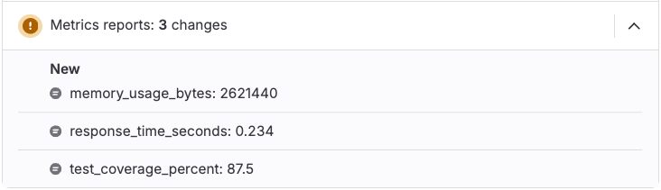



- Tier: Premium, Ultimate
- Offering: GitLab.com, GitLab Self-Managed, GitLab Dedicated



Metrics reports display custom metrics in merge requests to track performance,
memory usage, and other measurements between branches.

Use metrics reports to:

- Monitor memory usage changes.
- Track load testing results.
- Measure code complexity.
- Compare code coverage statistics.

## Metrics processing workflow

When a pipeline runs, GitLab reads metrics from the report artifact and stores them as string values
for comparison. The default filename is `metrics.txt`.

For a merge request, GitLab compares the metrics from the source branch to the values from a
[baseline pipeline](_index.md#baseline-pipeline-selection) on the target branch.
The merge request widget displays the metrics in this order:

- Existing metrics with changed values.
- Metrics added by the merge request (marked with a **New** badge).
- Metrics removed by the merge request (marked with a **Removed** badge).
- Existing metrics with unchanged values.

If the baseline pipeline has no metrics report artifacts, all metrics from the source branch
display as new.
The metrics comparison widget appears only when the source branch pipeline is in a
completed state and has metrics report artifacts.

## Configure metrics reports

Add metrics reports to your CI/CD pipeline to track custom metrics in merge requests.

Prerequisites:

- The metrics file must be a text file with one metric per line, in the format `<name> <value>`.
  The [OpenMetrics](https://prometheus.io/docs/instrumenting/exposition_formats/#openmetrics-text-format)
  text format meets this requirement.

To configure metrics reports:

1. In your `.gitlab-ci.yml` file, add a job that generates a metrics report.
1. Add a script to the job that generates metrics, with one `<name> <value>` per line.
1. Configure the job to upload the metrics file with [`artifacts:reports:metrics`](../yaml/artifacts_reports.md#artifactsreportsmetrics).

For example:

```yaml
metrics:
  stage: test
  script:
    - echo 'memory_usage_bytes 2621440' > metrics.txt
    - echo 'response_time_seconds 0.234' >> metrics.txt
    - echo 'test_coverage_percent 87.5' >> metrics.txt
    - echo '# EOF' >> metrics.txt
  artifacts:
    reports:
      metrics: metrics.txt
```

After the pipeline runs, the metrics reports display in the merge request widget.



For additional format specifications and examples, see
[Prometheus text format details](https://prometheus.io/docs/instrumenting/exposition_formats/#text-format-details).

## Troubleshooting

When working with metrics reports, you might encounter the following issues.

### Metrics reports did not change

You might see **Metrics report scanning detected no new changes** when viewing metrics reports in merge requests.

This issue occurs when your GitLab subscription doesn't include metrics reports,
which require the Premium or Ultimate tier. In that case, GitLab ignores the metrics,
so the message displays even when the metrics changed.

This issue also occurs when GitLab can't read any metrics from your metrics file.
For example, every line is a comment or has a metric name but no value.

To resolve this issue:

1. Verify your GitLab subscription tier includes metrics reports.
1. Verify each metric in your metrics file has a name followed by a value.
