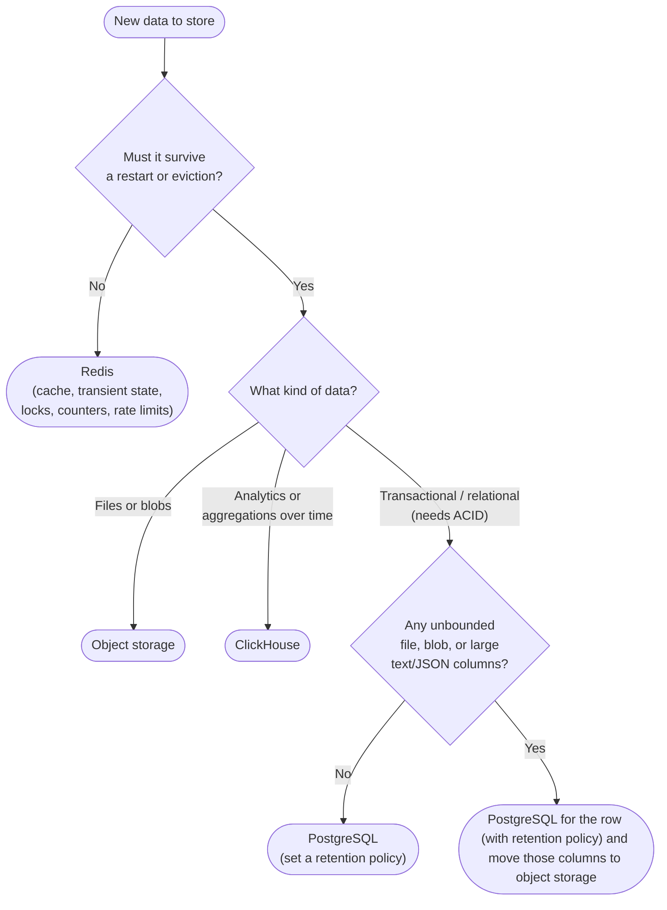

PostgreSQL is the approved [OLTP database](https://handbook.gitlab.com/handbook/engineering/architecture/abstractions/postgresql/) for GitLab.com and the default home for
relational and transactional data but it is not the right home for everything and forever. Blobs, large texts, serialized payloads, rendered HTML and event streams get into
PostgreSQL because it is the path of least resistance but it may not be the efficient storage of them.

Storing data in PostgreSQL which can reside elsewhere contributes to the fast growing database size, where horizontal scaling does not help and there is a ceiling
for vertical scaling. In addition, that data is replicated across different databases and can potentially slow down the entire application.

Making datastore decision during the design phase is the advised and easier path, because migrating large amount of data is a time taking process and reclaiming
those free spaces needs another processing in PostgreSQL.

## Available datastores

| Datastore                                     | Use for                                                                                                                | Do not use for                                                                                                                      | Homepage                                                                                |
|-----------------------------------------------|------------------------------------------------------------------------------------------------------------------------|-------------------------------------------------------------------------------------------------------------------------------------|-----------------------------------------------------------------------------------------|
| PostgreSQL                                    | Transactional data requiring ACID guarantees and structured data with complex relationships.                           | Data for OLAP queries, large binary or text data, high-frequency event streams, ephemeral cache data, full-text search, code search | [PostgreSQL key abstraction](https://handbook.gitlab.com/handbook/engineering/architecture/abstractions/postgresql/#use-cases) |
| Object storage                                | Files and blobs. Read heavy                                                                                            | Data needed to filter, sort or join and frequently updated ones                                                                     | [Object storage](../../administration/object_storage.md) |
| ClickHouse                                    | Analytics, aggregations over time ranges, append-only events and historical copies of PostgreSQL tables replicated with Siphon | Transactional reads on the request path and rows with frequent updates or deletes                                                   | [ClickHouse](../../integration/clickhouse.md) |
| Redis                                         | Caching, transient state that can be regenerated, coordination data (locks, counters, cursors), rate limiting, etc     | Anything that must survive a restart or eviction, data without a time to live (TTL) and large values                                | [Redis development guidelines](../redis.md) |

## Decision workflow

## Signals to not use PostgreSQL for extended time

When you see any of the below signals in a schema change or development, stop and apply the decision workflow.

- A `text` column without a limit or a `bytea` column.
- A `jsonb` column that stores payloads, checkpoints, or serialized state rather than a small set of
  validated attributes. The recommended maximum for `jsonb` is 64 KB, enforced for new validations by the `JsonbSizeLimit`
  cop. See [storing JSON in the database](../migration_style_guide.md#storing-json-in-database).
- Caching rendered output such as HTML generated from Markdown.
- Rows that are written once and not read after a few days or months, those should have proper retention policies implemented,
  to let go of unused data from the hot storage.
- Serialized or comma-separated values in a single column, see [serializing data](serializing_data.md).
- Intermediate data which is not referred or used often, for example, storing all edited versions of work item description.
- Data which needs to be stored forever.

## Tools

### Partitioning

Existing large tables and newly created tables that are expected to grow faster and larger should get partitioned, with a retention period
to drop old/unused partitions. Refer [partitioning](partitioning/_index.md) documentation.

When large tables are not partitioned, a proper justification should be captured in their [retention policy](database_growth_control/data_retention_policy.md).

### Moving TOAST data to object storage

In many tables, TOAST data contributes to the major size of the table (for example, `p_duo_workflows_checkpoints`, `description_versions`, and `duo_workflows_workflows`).

They can live outside the OLTP database. [Work item 607117](https://gitlab.com/gitlab-org/gitlab/-/work_items/607117)
builds a generic background operation which can move bulk of TOAST data to object storage.

### Archiving to a warehouse database

Long-lived data in PostgreSQL which can not be deleted with a retention policy, should get archived after a defined period and moved to a warehouse
database. So that only most frequently accessed data lives in the OLTP database and rarely requested data can sit in cheaper alternatives.

[Work item 23943](https://gitlab.com/groups/gitlab-org/-/work_items/23943) explores and builds tooling for archival.
