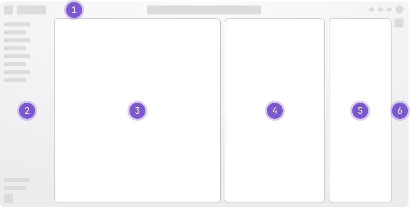

References to UI in the documentation must:

- Use shortcodes to flag the text as UI text.
- Match the UI text itself exactly, including capitalization.
  The only exception is UI text from an external tool that's all uppercase (for example, `RECENT FLOWS`).
  In this case, use sentence case.

UI elements include:

- Buttons
- Checkboxes
- Settings
- Menus
- Pages
- Tabs

If you think the user interface text contains style mistakes,
create an issue or an MR to propose a change to the user interface text.

## Mark UI text

The `ui` and `external-ui` shortcodes flag text as a UI element. Both render as bold on
`docs.gitlab.com` and in GitLab `/help`.

To mark a UI element, use one of the shortcodes:

- For GitLab, use `ui`:
  - Copy the string from the `locale/gitlab.pot` file. If the string has a [namespace](#namespaces), include it.
  - If the string does not exist in `gitlab.pot`, either the documentation and UI are out of sync or
    the UI text is hardcoded. Find the correct string and update the documentation, or use bold for hardcoded strings.
  - If the string ends in an ellipsis (`...` or `…`), do not include the ellipsis in the shortcode.
- For a non-GitLab product, use `external-ui`. Match the other product's UI string as closely as you can.

The following example includes a hardcoded string:

```markdown
1. In the left sidebar, select  > .
1. Select the  checkbox.
1. Select **Jenkins**.
```

External UI example:

```markdown
1. On your Jenkins instance, select .
```

Example with namespaces:

```markdown
1. In the right sidebar, in the  section, select .
```

A CI/CD job checks every `ui` string against `locale/gitlab.pot`. The job fails when
a documented UI string is not found in the `gitlab.pot` file.
The job ignores `external-ui` strings.

### Namespaces

If a UI text string has a [namespace](../../i18n/externalization.md#namespaces),
you must include it in the shortcode.

Some strings occur multiple times in the `gitlab.pot` file but with different namespaces,
or no namespace. Check if there are multiple namespaces and use the one that matches
the area of the UI mentioned in the documentation.

The namespace does not display when the page renders. For example:

- `gitlab.pot` file: `msgid "Job|Cancel"`
- Shortcode: ``
- Rendered: 

## Navigation

When documenting how to navigate the GitLab UI:

- Always use location, then action.
  - From the  dropdown list (location), select  (action).
- Be brief and specific. For example:
  - Do: Select .
  - Do not: Select  for the changes to take effect.
- If a step must include a reason, start the step with it. This helps the user scan more quickly.
  - Do: To view the changes, in the merge request, select the link.
  - Do not: Select the link in the merge request to view the changes.

### Names for UI elements

In the GitLab UI, use the following names:



1. **Top bar**
1. **Left sidebar**: The navigation sidebar on the left of the user interface.
   - Do not use the phrase `the Explore menu` or `the Your work sidebar`. Instead, use `the left sidebar`.
1. **... panel**: Based on the primary context. For example, if the context is a merge request, refer to it as the **merge request panel**.
1. **Details panel**: Supports the primary context. Specific to the selected issue or epic.
1. **GitLab Duo panel**
1. **GitLab Duo sidebar**

The **right sidebar** is the navigation sidebar on the right of the user interface,
specific to an open issue, merge request, or epic.

With the exception of **GitLab Duo**, use lowercase for all above terms.

Additional guidance for individual UI elements is in [the word list](word_list.md).

### How to write navigation task steps

To be consistent, use these examples to write navigation steps in a task topic.
Although alternative steps might exist, including items pinned by default,
use these steps instead.

To open project settings:

```markdown
1. In the top bar, select  and find your project.
1. In the left sidebar, select  > .
1. Expand .
```

To open group settings:

```markdown
1. In the top bar, select  and find your group.
1. In the left sidebar, select  > .
1. Expand .
```

To open settings for a top-level group:

```markdown
1. In the top bar, select  and find your group.
   This group must be at the top level.
1. In the left sidebar, select  > .
1. Expand .
```

To open either project or group settings:

```markdown
1. In the top bar, select  and find your project or group.
1. In the left sidebar, select  > .
1. Expand .
```

To create a project:

```markdown
1. In the upper-right corner, select  () and .
```

To create a group:

```markdown
1. In the upper-right corner, select  () and .
```

To open the **Admin** area:

```markdown
1. In the upper-right corner, select .
1. In the left sidebar, select  > .
```

To open the **Your work** menu item:

```markdown
1. In the top bar, select .
1. Select .
```

To select your avatar:

```markdown
1. In the upper-right corner, select your avatar.
```

To save the selection in some dropdown lists:

```markdown
1. Go to your issue.
1. In the right sidebar, in the  section, select .
1. From the dropdown list, select the iteration to associate this issue with.
1. Select any area outside the dropdown list.
```

To view all your projects:

```markdown
1. In the top bar, select .
1. Select .
```

To view all your groups:

```markdown
1. In the top bar, select .
1. Select .
```

### Optional steps

If a step is optional, start the step with the word `Optional` followed by a period.

For example:

```markdown
1. Optional. Enter a description for the job.
```

### Recommended steps

If a step is recommended, start the step with the word `Recommended` followed by a period.

For example:

```markdown
1. Recommended. Enter a description for the job.
```

### Documenting keyboard shortcuts and commands

Write UI instructions instead of keyboard commands when both options exist.
This guideline applies to GitLab and third-party applications, like VS Code.

Keyboard commands for GitLab are documented in [GitLab keyboard shortcuts](../../../user/shortcuts.md).

### Documenting multiple fields in one step

If the UI text sufficiently explains the fields in a section, do not include a task step for every field.
Instead, summarize multiple fields in a single task step.

Use the phrase **Complete the fields**.

For example:

```markdown
1. In the top bar, select  and find your project.
1. In the left sidebar, select  > .
1. Expand .
1. Complete the fields.
```

If you are documenting multiple fields and only one field needs explanation, do it in the same step:

```markdown
1. Expand .
1. Complete the fields.  must be a regular expression.
```

To describe multiple fields, use unordered list items:

```markdown
1. Select .
1. Complete the fields.
   - : Select one of the preconfigured
     intervals, or enter a custom interval.
   - : Add any number of CI/CD variables to the schedule.
```
